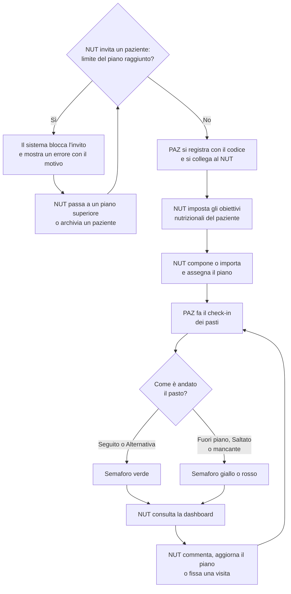

# 3.1 Panoramica (Overview)

Il sistema è un'app mobile con due ruoli e un back-end cloud (Supabase, regione UE, vedi Registro delle decisioni §2). Ogni requisito di questo capitolo discende da una decisione del Business Model; la tracciabilità è nella sezione 8 del BMC.

**Il Nutrizionista può:** registrarsi e accedere; scegliere e cambiare il proprio piano di abbonamento (simulato); invitare pazienti entro il limite del piano; vedere l'elenco clienti con semaforo di aderenza, filtrarlo per stato e archiviare i pazienti; impostare gli obiettivi nutrizionali di un paziente; creare e assegnare un piano (cercando gli alimenti, anche da barcode, usando giorno tipo, pasti salvati e modelli, oppure importando un file CSV) e vedere lo scostamento dagli obiettivi; consultare check-in, peso e grafici di un paziente e commentare un check-in; indicare giorni e orari di ricevimento, indicare per ogni paziente il periodo in cui può prenotare, fissare visite e consultare il calendario con gli slot liberi.

**Il Paziente può:** registrarsi con un invito e accedere; consultare nella sezione Dieta il piano e gli obiettivi; fare il check-in dei pasti (Seguito, Alternativa, Fuori piano, Saltato), segnalare un pasto extra; registrare il peso e vedere nella sezione Andamento peso, aderenza e commenti del nutrizionista; ricevere promemoria e avvisi; vedere la prossima visita, prenotarla tra gli slot liberi e annullarla entro il termine.

## 3.1.1 Attori del sistema

- **Nutrizionista (NUT):** professionista che segue i pazienti; utente pagante (segmento S1 del BMC).
- **Paziente (PAZ):** persona seguita da un nutrizionista; utente finale non pagante (segmento S2 del BMC).
- **Utente:** generalizzazione di NUT e PAZ.
- **Attori esterni (sistemi):** *Servizio alimenti* (Open Food Facts) per la ricerca e il barcode usati dal nutrizionista nell'editor del piano; *Servizio notifiche push*. Il *servizio di pagamento* non è un attore dell'MVP (pagamento simulato).

## 3.1.2 Activity Diagram del sistema proposto (flusso principale)

## 3.1.3 Funzionalità dell'MVP

Quanto promesso è quanto dimostrato in live demo.

**Ruolo Paziente**

1. Registrazione/login e collegamento al nutrizionista tramite link o codice di invito.
2. Sezione **Dieta**: piano (pasti con alimenti, quantità e alternative) e obiettivi nutrizionali.
3. Sezione **Oggi**, **check-in a un tap:** Seguito, Alternativa (scelta tra quelle del nutrizionista), Fuori piano (etichetta rapida o nota), Saltato; segnalazione di un pasto extra.
4. Sezione **Andamento**: registrazione del peso, grafici, aderenza della settimana, commenti del nutrizionista.
5. Promemoria e avvisi sulle visite.
6. Sezione **Visite**: prossima visita, prenotazione tra gli slot liberi nella finestra stabilita dal nutrizionista e annullamento.
7. Storico dei check-in dei giorni passati.

**Ruolo Nutrizionista**

1. Login, inviti e **piano di abbonamento** con limiti reali (Free 1 a vita, Start 5 attivi, Pro illimitati) e pagamento simulato.
2. **Elenco clienti con semaforo**; stati Invitato/Attivo/Archiviato; filtri Attivi / Archiviati / Tutti, ordinamento per semaforo e ricerca per nome; i pazienti si archiviano, non si eliminano.
3. **Obiettivi nutrizionali** per paziente (kcal e macro) e **editor del piano:** ricerca alimenti, barcode (Open Food Facts), alimento personalizzato, alternative, giorno tipo con copia, pasti salvati e piani modello, alimenti recenti, quantità rapide, scostamento dagli obiettivi.
4. **Importazione da file CSV** con modello scaricabile, anteprima ed elenco degli errori.
5. Vista dei check-in, **aderenza per pasto** (quali pasti il paziente salta più spesso) e commento.
6. **Agenda completa:** disponibilità indicate alla registrazione (giorni, orari, durata), finestra di prenotazione per paziente, calendario settimanale/mensile con slot liberi e selezione del cliente, visita fissata dal nutrizionista o prenotata dal paziente, avvisi in app, prossima e ultima visita nella scheda cliente.
7. Spazio sponsor statico nel piano Free.

**Requisiti non funzionali da documentare:** privacy e sicurezza (GDPR art. 9: consenso esplicito, accessi per ruolo, cifratura), usabilità, prestazioni, Android/iOS.
**Stack ipotizzato:** Flutter + Supabase (Auth, Postgres con Row Level Security, notifiche), da confermare con il docente (Registro delle decisioni §2).

**Limiti noti dell'inserimento da telefono (sintesi):** comporre un piano sullo smartphone è faticoso; li mitighiamo con giorno tipo, modelli, importazione, alimenti recenti e quantità rapide. Il web è lo sviluppo naturale (BMC §7). La ricerca per nome di Open Food Facts è meno affidabile del barcode e non contiene tutti i prodotti: per i generici si usa l'alimento personalizzato.

## 3.1.4 Priorità, fattibilità e limiti noti

Le funzionalità a priorità **A** costituiscono il nucleo dell'MVP; le **M** completano l'MVP e si realizzano dopo le A. L'agenda (RF_GV) è a priorità Alta e viene completata. L'editor del piano (RF_GP_1–3, RF_GP_7) e il calcolo dei limiti dei piani (RF_GAD_4) sono le parti più delicate e vanno avviate per prime. Se il tempo fosse insufficiente, le funzioni da rinviare per prime sono la scansione barcode (RF_GP_4, resta la ricerca testuale), poi lo spazio sponsor e le quantità rapide; in tal caso si aggiornano il BMC, il pitch e questo documento, per non promettere ciò che non si mostra.

**Limiti noti**

- Comporre un piano da smartphone è faticoso: lo mitighiamo con giorno tipo, modelli, importazione, alimenti recenti e quantità rapide; la versione web è lo sviluppo naturale.
- La ricerca per nome di Open Food Facts è meno affidabile del barcode e non contiene tutti i prodotti: per i generici si usa l'alimento personalizzato.
- La creazione di più account da parte della stessa persona non è impedibile nell'MVP.
- Il pagamento è simulato: i limiti e il cambio di piano sono reali, l'incasso no.
- Le soglie del semaforo e la regola di aderenza vanno validate con un consulente nutrizionista.
