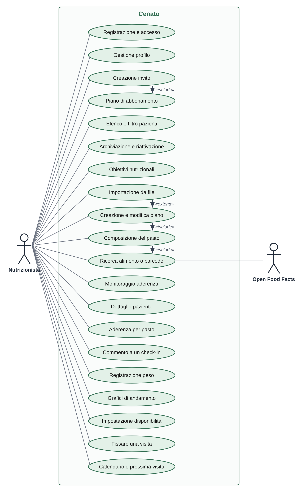
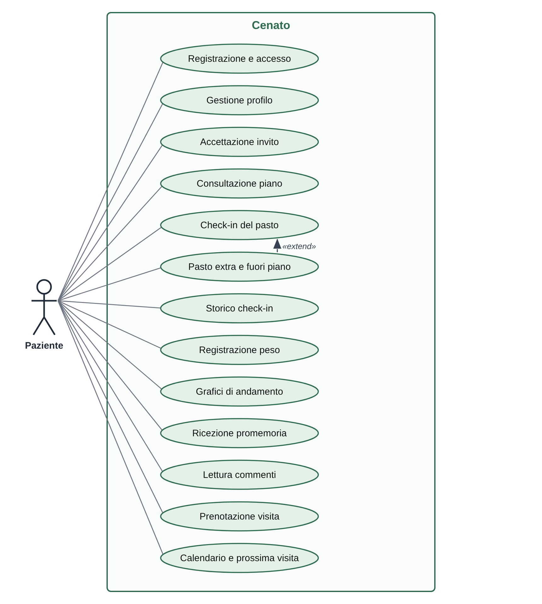

# 3.4.2 Modello dei casi d'uso (Use case model)

**Elenco dei casi d'uso**

| ID | Nome | Attore | Requisiti collegati |
|---|---|---|---|
| UC_GA_1 | Registrazione | NUT, PAZ | RF_GA_1, RF_GA_6 |
| UC_GA_2 | Accesso e logout | NUT, PAZ | RF_GA_2, RF_GA_3 |
| UC_GA_3 | Gestione profilo | NUT, PAZ | RF_GA_5 |
| UC_GA_4 | Recupero password | NUT, PAZ | RF_GA_4 |
| UC_GA_5 | Eliminazione account | NUT, PAZ | RF_GA_7 |
| UC_GI_1 | Creazione invito | NUT | RF_GI_1, RF_GI_8, RF_GAD_7 |
| UC_GI_2 | Accettazione invito | PAZ | RF_GI_2 |
| UC_GI_3 | Visualizzazione e filtro pazienti | NUT | RF_GI_3, RF_GI_6 |
| UC_GI_4 | Archiviazione e riattivazione paziente | NUT | RF_GI_4, RF_GI_5 |
| UC_GI_5 | Scollegamento da parte del paziente | PAZ | RF_GI_7 |
| UC_GP_1 | Creazione e modifica piano | NUT | RF_GP_1, RF_GP_7, RF_GP_9, RF_GP_13 |
| UC_GP_2 | Composizione del pasto | NUT | RF_GP_2, RF_GP_5, RF_GP_6, RF_GP_14, RF_GP_15 |
| UC_GP_3 | Ricerca alimento o scansione barcode | NUT | RF_GP_3, RF_GP_4 |
| UC_GP_4 | Consultazione piano | PAZ | RF_GP_8, RF_GP_16 |
| UC_GP_5 | Importazione piano da file | NUT | RF_GP_10, RF_GP_11 |
| UC_GP_6 | Impostazione obiettivi nutrizionali | NUT | RF_GP_16 |
| UC_GD_1 | Check-in del pasto | PAZ | RF_GD_1, RF_GD_2, RF_GD_3, RF_GD_4 |
| UC_GD_2 | Pasto extra e fuori piano rapido | PAZ | RF_GD_6, RF_GD_7 |
| UC_GD_3 | Storico dei check-in | PAZ | RF_GD_8 |
| UC_GM_1 | Registrazione peso | PAZ, NUT | RF_GM_1 |
| UC_GM_2 | Andamento del percorso | PAZ, NUT | RF_GM_2, RF_GM_4 |
| UC_GM_3 | Aderenza per pasto | NUT | RF_GM_5 |
| UC_GN_1 | Ricezione promemoria e avvisi | PAZ, NUT | RF_GN_1, RF_GN_3, RF_GN_4, RF_GN_5, RF_GN_6 |
| UC_GN_2 | Impostazione promemoria | PAZ | RF_GN_2 |
| UC_GC_1 | Commento a un check-in | NUT | RF_GC_1 |
| UC_GC_2 | Lettura commenti | PAZ | RF_GC_2 |
| UC_GV_1 | Fissare una visita | NUT | RF_GV_1, RF_GV_4 |
| UC_GV_2 | Calendario e prossima visita | NUT, PAZ | RF_GV_2, RF_GV_3, RF_GV_5 |
| UC_GV_3 | Impostazione disponibilità | NUT | RF_GV_6, RF_GV_7 |
| UC_GV_4 | Prenotazione e annullamento di una visita | PAZ | RF_GV_8, RF_GV_9 |
| UC_GAD_1 | Monitoraggio aderenza (dashboard) | NUT | RF_GAD_1, RF_GAD_2 |
| UC_GAD_2 | Dettaglio paziente | NUT | RF_GAD_3 |
| UC_GAD_3 | Piano di abbonamento | NUT | RF_GAD_4, RF_GAD_5, RF_GAD_6 |

Relazioni tra casi d'uso: UC_GP_6 è precondizione di UC_GP_1; UC_GV_4 usa gli slot definiti da UC_GV_3; UC_GM_3 e UC_GC_1 *includono* UC_GAD_2; UC_GP_1 *include* UC_GP_2; UC_GP_2 *include* UC_GP_3; UC_GP_1 *estende* verso UC_GP_5 (partenza da file); UC_GI_1 *include* la verifica del limite del piano (UC_GAD_3) e, se il limite è raggiunto, mostra un errore; UC_GAD_1 *estende* verso UC_GAD_2; UC_GD_2 *estende* UC_GD_1.

**Use Case Diagram**

**Descrizione dei casi d'uso**

Ogni caso d'uso è descritto in una tabella con identificativo, attori, condizioni di ingresso e di uscita, priorità, frequenza stimata (stima di progetto da validare), flusso principale e flussi alternativi o di errore. Lo scenario corrispondente è nel §3.4.1.

**Gestione Account**

**UC_GA_1** — Registrazione

Lo UC permette a un nuovo utente di creare un account scegliendo il ruolo e accettando il consenso al trattamento dei dati sanitari.

| Campo | Valore |
|---|---|
| Attore principale | Utente: L'utente (Nutrizionista o Paziente) vuole accedere ai servizi di Cenato |
| Condizioni di ingresso | • L'utente ha installato l'app • L'utente non è autenticato |
| Condizione di uscita (successo) | L'account è creato; il Nutrizionista ha il piano Free e ha indicato le disponibilità; il Paziente è collegato al nutrizionista dell'invito |
| Condizione di uscita (fallimento) | L'account non viene creato |
| Priorità | Alta |
| Frequenza stimata | 20/settimana |
| Extends / Includes | UC_GV_3 – Impostazione disponibilità (solo NUT) |
| Generalizza | NA |
| Requisiti speciali | RNF_U_4, RNF_L_1 |

**Flusso principale**

| # | Attore | Passo |
|---|---|---|
| 1 | Utente | L'utente apre l'app e tocca "Registrati" |
| 2 | Sistema | Il sistema chiede il ruolo (Nutrizionista o Paziente) |
| 3 | Utente | L'utente sceglie il ruolo |
| 4 | Sistema | Il sistema mostra il modulo con nome, email e password; per il Paziente anche il campo del codice di invito |
| 5 | Utente | L'utente compila il modulo |
| 6 | Sistema | Il sistema mostra l'informativa sul trattamento dei dati sanitari (GDPR art. 9) e la richiesta di consenso esplicito |
| 7 | Utente | L'utente accetta il consenso e conferma |
| 8 | Sistema | Il sistema crea l'account; il Nutrizionista prosegue con UC_GV_3, il Paziente con il collegamento al nutrizionista (UC_GI_2) |

**Flusso di errore: Email già registrata o dati non validi**

| # | Attore | Passo |
|---|---|---|
| 4.1 | Sistema | Il sistema segnala il campo errato e non crea l'account |

**Flusso di errore: Consenso non accettato**

| # | Attore | Passo |
|---|---|---|
| 7.1 | Sistema | Il sistema non consente di proseguire e spiega che il consenso è necessario |

**Flusso di errore: Errore di connessione**

| # | Attore | Passo |
|---|---|---|
| 8.1 | Sistema | Il sistema informa dell'errore e consente di riprovare |

**UC_GA_2** — Accesso e logout

Lo UC permette a un utente registrato di accedere al sistema con le proprie credenziali e di uscire.

| Campo | Valore |
|---|---|
| Attore principale | Utente: L'utente vuole usare l'app con il proprio account |
| Condizioni di ingresso | • L'utente è registrato • L'utente non è autenticato (accesso) oppure è autenticato (logout) |
| Condizione di uscita (successo) | L'utente accede alla home del proprio ruolo (Oggi per il Paziente, elenco pazienti per il Nutrizionista) oppure esce dall'account |
| Condizione di uscita (fallimento) | L'utente resta non autenticato |
| Priorità | Alta |
| Frequenza stimata | 200/giorno |
| Extends / Includes | NA |
| Generalizza | NA |
| Requisiti speciali | RNF_A_4 |

**Flusso principale**

| # | Attore | Passo |
|---|---|---|
| 1 | Utente | L'utente apre l'app |
| 2 | Sistema | Il sistema mostra la schermata di login; con una sessione valida passa direttamente al punto 6 |
| 3 | Utente | L'utente inserisce email e password e tocca "Accedi" |
| 4 | Sistema | Il sistema verifica le credenziali |
| 5 | Sistema | Il sistema riconosce il ruolo dell'utente |
| 6 | Sistema | Il sistema apre la home del ruolo |
| 7 | Utente | Per uscire, l'utente tocca "Logout" dal profilo |
| 8 | Sistema | Il sistema chiude la sessione e torna al login |

**Flusso di errore: Credenziali errate**

| # | Attore | Passo |
|---|---|---|
| 4.1 | Sistema | Il sistema mostra un messaggio d'errore e propone il recupero della password (UC_GA_4) |

**Flusso di errore: Rete assente**

| # | Attore | Passo |
|---|---|---|
| 4.2 | Sistema | Il sistema informa che non è possibile accedere e consente di riprovare |

**UC_GA_3** — Gestione profilo

Lo UC permette all'utente di consultare e modificare i propri dati di profilo.

| Campo | Valore |
|---|---|
| Attore principale | Utente: L'utente vuole mantenere aggiornati i propri dati |
| Condizioni di ingresso | • L'utente è autenticato |
| Condizione di uscita (successo) | I dati del profilo sono aggiornati |
| Condizione di uscita (fallimento) | I dati restano invariati |
| Priorità | Alta |
| Frequenza stimata | 5/settimana |
| Extends / Includes | UC_GV_3 – Impostazione disponibilità (NUT) |
| Generalizza | NA |

**Flusso principale**

| # | Attore | Passo |
|---|---|---|
| 1 | Utente | L'utente apre "Profilo" |
| 2 | Sistema | Il sistema mostra i dati del profilo (per il Paziente altezza, data di nascita, obiettivo; per il Nutrizionista titolo e disponibilità) |
| 3 | Utente | L'utente tocca "Modifica" e cambia i dati |
| 4 | Sistema | Il sistema valida i valori inseriti |
| 5 | Utente | L'utente salva |
| 6 | Sistema | Il sistema aggiorna il profilo e conferma |

**Flusso di errore: Valori non validi**

| # | Attore | Passo |
|---|---|---|
| 4.1 | Sistema | Il sistema segnala i campi errati e non salva |

**UC_GA_4** — Recupero password

Lo UC permette all'utente che ha dimenticato la password di impostarne una nuova tramite email.

| Campo | Valore |
|---|---|
| Attore principale | Utente: L'utente vuole recuperare l'accesso al proprio account |
| Condizioni di ingresso | • L'utente è registrato • L'utente non ricorda la password |
| Condizione di uscita (successo) | L'utente imposta una nuova password e può accedere |
| Condizione di uscita (fallimento) | La password non viene cambiata |
| Priorità | Media |
| Frequenza stimata | 5/settimana |
| Extends / Includes | NA |
| Generalizza | NA |
| Requisiti speciali | RNF_A_4 |

**Flusso principale**

| # | Attore | Passo |
|---|---|---|
| 1 | Utente | L'utente tocca "Password dimenticata" nel login |
| 2 | Sistema | Il sistema chiede l'indirizzo email |
| 3 | Utente | L'utente inserisce l'email |
| 4 | Sistema | Il sistema invia un'email con un link di reimpostazione (messaggio identico anche se l'email non esiste) |
| 5 | Utente | L'utente apre il link e inserisce la nuova password |
| 6 | Sistema | Il sistema aggiorna la password e riporta al login |

**Flusso di errore: Link scaduto**

| # | Attore | Passo |
|---|---|---|
| 5.1 | Sistema | Il sistema informa che il link non è più valido e propone una nuova richiesta |

**UC_GA_5** — Eliminazione account

Lo UC permette all'utente di richiedere la cancellazione del proprio account e dei propri dati (GDPR).

| Campo | Valore |
|---|---|
| Attore principale | Utente: L'utente esercita il diritto alla cancellazione dei dati |
| Attore secondario | Nutrizionista: Se a cancellarsi è un paziente, il nutrizionista non vedrà più i suoi dati |
| Condizioni di ingresso | • L'utente è autenticato |
| Condizione di uscita (successo) | Account e dati personali sono eliminati |
| Condizione di uscita (fallimento) | L'account resta attivo |
| Priorità | Media |
| Frequenza stimata | 1/mese |
| Extends / Includes | NA |
| Generalizza | NA |
| Requisiti speciali | RNF_L_3 |

**Flusso principale**

| # | Attore | Passo |
|---|---|---|
| 1 | Utente | L'utente apre "Profilo" e tocca "Elimina account" |
| 2 | Sistema | Il sistema spiega le conseguenze (i dati non saranno recuperabili) e chiede la password |
| 3 | Utente | L'utente conferma inserendo la password |
| 4 | Sistema | Il sistema elimina i dati personali dell'utente e chiude la sessione |
| 5 | Sistema | Il sistema mostra la schermata di conferma |

**Flusso alternativo: Il Nutrizionista ha pazienti collegati**

| # | Attore | Passo |
|---|---|---|
| 2.1 | Sistema | Il sistema avvisa che i pazienti collegati perderanno l'accesso ai dati condivisi e chiede una conferma aggiuntiva |

**Flusso di errore: Password errata**

| # | Attore | Passo |
|---|---|---|
| 3.1 | Sistema | Il sistema non elimina nulla e mostra l'errore |

**Gestione Inviti e Pazienti**

**UC_GI_1** — Creazione invito

Lo UC permette al nutrizionista di creare un invito (codice e link) per collegare un nuovo paziente, nel rispetto del limite del piano di abbonamento.

| Campo | Valore |
|---|---|
| Attore principale | Nutrizionista: Il nutrizionista vuole collegare un nuovo paziente a Cenato |
| Attore secondario | Paziente: Il paziente riceverà il codice per collegarsi al nutrizionista |
| Condizioni di ingresso | • Il nutrizionista è autenticato • Il nutrizionista si trova nella sezione Pazienti |
| Condizione di uscita (successo) | L'invito è creato e può essere condiviso |
| Condizione di uscita (fallimento) | L'invito non viene creato (limite del piano raggiunto o errore) |
| Priorità | Alta |
| Frequenza stimata | 10/settimana |
| Extends / Includes | UC_GAD_3 – Piano di abbonamento |
| Generalizza | NA |
| Requisiti speciali | RF_GAD_7: il messaggio di errore al limite è obbligatorio |

**Flusso principale**

| # | Attore | Passo |
|---|---|---|
| 1 | Nutrizionista | Il nutrizionista tocca "Invita" |
| 2 | Sistema | Il sistema verifica il piano e il numero di pazienti (include la verifica del limite, UC_GAD_3) |
| 3 | Sistema | Il sistema genera un codice valido 7 giorni [DA CONFERMARE] e un link di invito |
| 4 | Sistema | Il sistema mostra codice e link con il pulsante "Condividi" |
| 5 | Nutrizionista | Il nutrizionista condivide l'invito (ad esempio via WhatsApp) |
| 6 | Sistema | Il sistema mostra l'invito tra quelli in attesa, con stato Creato |

**Flusso di errore: Limite del piano raggiunto**

| # | Attore | Passo |
|---|---|---|
| 2.1 | Sistema | Il sistema blocca l'invito e mostra un messaggio di errore con il motivo ("Hai raggiunto il limite del piano Free: 1 paziente") |
| 2.2 | Sistema | Il sistema propone di passare a un piano superiore (UC_GAD_3) oppure, nei piani Start e Pro, di archiviare un paziente (UC_GI_4) |

**Flusso alternativo: Revoca di un invito non ancora usato**

| # | Attore | Passo |
|---|---|---|
| 6.1 | Nutrizionista | Il nutrizionista tocca "Revoca" su un invito in attesa |
| 6.2 | Sistema | Il sistema imposta l'invito come Revocato; il codice non è più utilizzabile |

**Flusso di errore: Errore di connessione**

| # | Attore | Passo |
|---|---|---|
| 3.1 | Sistema | Il sistema informa dell'errore e non crea l'invito |

**UC_GI_2** — Accettazione invito

Lo UC permette al paziente di collegarsi al proprio nutrizionista inserendo il codice di invito.

| Campo | Valore |
|---|---|
| Attore principale | Paziente: Il paziente vuole essere seguito dal proprio nutrizionista tramite l'app |
| Attore secondario | Nutrizionista: Il nutrizionista vedrà il paziente nell'elenco con stato Attivo |
| Condizioni di ingresso | • Il paziente ha ricevuto un codice o un link di invito • Il paziente sta completando la registrazione (UC_GA_1) |
| Condizione di uscita (successo) | Il paziente è collegato al nutrizionista con stato Attivo |
| Condizione di uscita (fallimento) | Il paziente non è collegato |
| Priorità | Alta |
| Frequenza stimata | 10/settimana |
| Extends / Includes | NA |
| Generalizza | NA |

**Flusso principale**

| # | Attore | Passo |
|---|---|---|
| 1 | Paziente | Il paziente inserisce il codice di invito (o apre il link) |
| 2 | Sistema | Il sistema verifica che il codice sia valido, non scaduto e non già usato |
| 3 | Sistema | Il sistema mostra il nome del nutrizionista e chiede conferma |
| 4 | Paziente | Il paziente conferma |
| 5 | Sistema | Il sistema collega il paziente, imposta lo stato Attivo e aggiorna il contatore dei pazienti del nutrizionista |
| 6 | Sistema | Il sistema mostra la home Oggi del paziente |

**Flusso di errore: Codice non valido, scaduto o già usato**

| # | Attore | Passo |
|---|---|---|
| 2.1 | Sistema | Il sistema mostra un errore e invita a chiedere un nuovo invito al nutrizionista |

**Flusso di errore: Il nutrizionista ha raggiunto il limite nel frattempo**

| # | Attore | Passo |
|---|---|---|
| 5.1 | Sistema | Il sistema non collega il paziente e lo invita a contattare il nutrizionista |

**UC_GI_3** — Visualizzazione e filtro pazienti

Lo UC permette al nutrizionista di vedere l'elenco dei propri pazienti, filtrarlo per stato, ordinarlo e cercare per nome.

| Campo | Valore |
|---|---|
| Attore principale | Nutrizionista: Il nutrizionista vuole una panoramica dei propri pazienti |
| Condizioni di ingresso | • Il nutrizionista è autenticato |
| Condizione di uscita (successo) | Il nutrizionista vede i pazienti secondo il filtro scelto |
| Condizione di uscita (fallimento) | L'elenco non viene mostrato |
| Priorità | Alta |
| Frequenza stimata | 50/giorno |
| Extends / Includes | NA |
| Generalizza | NA |

**Flusso principale**

| # | Attore | Passo |
|---|---|---|
| 1 | Nutrizionista | Il nutrizionista apre la sezione Pazienti |
| 2 | Sistema | Il sistema mostra l'elenco dei pazienti Attivi con semaforo, ultimo check-in e prossima visita |
| 3 | Nutrizionista | Il nutrizionista cambia il filtro (Attivi, Archiviati, Tutti) |
| 4 | Sistema | Il sistema aggiorna l'elenco |
| 5 | Nutrizionista | Il nutrizionista ordina per semaforo o cerca un paziente per nome |
| 6 | Sistema | Il sistema mostra il risultato |

**Flusso alternativo: Nessun paziente**

| # | Attore | Passo |
|---|---|---|
| 2.1 | Sistema | Il sistema mostra un messaggio e propone di creare un invito (UC_GI_1) |

**Flusso di errore: Errore di caricamento**

| # | Attore | Passo |
|---|---|---|
| 2.2 | Sistema | Il sistema mostra un messaggio e un pulsante per ricaricare |

**UC_GI_4** — Archiviazione e riattivazione paziente

Lo UC permette al nutrizionista di archiviare un paziente (che non può essere eliminato) e di riattivarlo.

| Campo | Valore |
|---|---|
| Attore principale | Nutrizionista: Il nutrizionista ha concluso o sospeso il percorso di un paziente |
| Condizioni di ingresso | • Il nutrizionista è autenticato • Il paziente è collegato (Attivo) o archiviato |
| Condizione di uscita (successo) | Lo stato del paziente è cambiato e lo storico è conservato |
| Condizione di uscita (fallimento) | Lo stato non cambia |
| Priorità | Alta |
| Frequenza stimata | 5/settimana |
| Extends / Includes | NA |
| Generalizza | NA |
| Requisiti speciali | Non esiste l'azione "Elimina paziente" per i pazienti collegati |

**Flusso principale**

| # | Attore | Passo |
|---|---|---|
| 1 | Nutrizionista | Il nutrizionista apre il profilo del paziente e tocca "Archivia" |
| 2 | Sistema | Il sistema spiega che il paziente non verrà eliminato e che lo storico resta consultabile |
| 3 | Nutrizionista | Il nutrizionista conferma |
| 4 | Sistema | Il sistema imposta lo stato Archiviato, annulla le visite future del paziente e avvisa il nutrizionista; nei piani Start e Pro libera un posto |

**Flusso alternativo: Riattivazione**

| # | Attore | Passo |
|---|---|---|
| 1.1 | Nutrizionista | Il nutrizionista tocca "Riattiva" su un paziente archiviato |
| 1.2 | Sistema | Il sistema verifica il limite del piano e riporta il paziente ad Attivo |

**Flusso alternativo: Piano Free**

| # | Attore | Passo |
|---|---|---|
| 4.1 | Sistema | L'archiviazione non libera il posto: il Free conta tutti i pazienti che hanno accettato un invito |

**Flusso di errore: Riattivazione oltre il limite**

| # | Attore | Passo |
|---|---|---|
| 1.3 | Sistema | Il sistema blocca la riattivazione e propone di cambiare piano (UC_GAD_3) |

**UC_GI_5** — Scollegamento da parte del paziente

Lo UC permette al paziente di interrompere il collegamento con il proprio nutrizionista.

| Campo | Valore |
|---|---|
| Attore principale | Paziente: Il paziente non vuole più essere seguito tramite l'app |
| Attore secondario | Nutrizionista: Il nutrizionista vede il paziente passare ad Archiviato |
| Condizioni di ingresso | • Il paziente è autenticato • Il paziente è collegato a un nutrizionista |
| Condizione di uscita (successo) | Il paziente è Archiviato e non riceve più notifiche |
| Condizione di uscita (fallimento) | Il collegamento resta attivo |
| Priorità | Media |
| Frequenza stimata | 1/mese |
| Extends / Includes | NA |
| Generalizza | NA |
| Requisiti speciali | Nel piano Free il paziente continua a essere contato nel limite |

**Flusso principale**

| # | Attore | Passo |
|---|---|---|
| 1 | Paziente | Il paziente apre "Profilo" e tocca "Interrompi il collegamento" |
| 2 | Sistema | Il sistema spiega che il nutrizionista non vedrà più i nuovi dati e chiede conferma |
| 3 | Paziente | Il paziente conferma |
| 4 | Sistema | Il sistema imposta lo stato Archiviato, annulla le visite future e avvisa il nutrizionista |

**Flusso di errore: Errore di connessione**

| # | Attore | Passo |
|---|---|---|
| 4.1 | Sistema | Il sistema non modifica lo stato e consente di riprovare |

**Gestione Piano**

**UC_GP_1** — Creazione e modifica piano

Lo UC permette al nutrizionista di creare, modificare e assegnare il piano alimentare di un paziente.

| Campo | Valore |
|---|---|
| Attore principale | Nutrizionista: Il nutrizionista vuole assegnare al paziente un piano coerente con gli obiettivi nutrizionali |
| Attore secondario | Paziente: Il paziente consulterà il piano nella sezione Dieta |
| Condizioni di ingresso | • Il nutrizionista è autenticato • Il paziente è collegato • Sono stati impostati gli obiettivi nutrizionali (UC_GP_6) |
| Condizione di uscita (successo) | Il piano è salvato come nuova versione e il paziente è avvisato |
| Condizione di uscita (fallimento) | Il piano non viene salvato |
| Priorità | Alta |
| Frequenza stimata | 20/settimana |
| Extends / Includes | UC_GP_5 – Importazione piano da file |
| Generalizza | NA |
| Requisiti speciali | RNF_U_5: giorno tipo con copia, pasti salvati, alimenti recenti, quantità rapide |
| Note | I check-in già registrati restano associati alla versione precedente |

**Flusso principale**

| # | Attore | Passo |
|---|---|---|
| 1 | Sistema | include (UC_GP_6 – obiettivi nutrizionali, se mancanti) |
| 2 | Nutrizionista | Il nutrizionista apre il profilo del paziente e tocca "Nuovo piano" (o "Modifica piano") |
| 3 | Sistema | Il sistema chiede data di inizio, giorni e pasti previsti |
| 4 | Nutrizionista | Il nutrizionista li imposta |
| 5 | Sistema | include (UC_GP_2 – Composizione del pasto) per ogni pasto |
| 6 | Nutrizionista | Il nutrizionista può copiare un giorno su altri giorni della settimana |
| 7 | Sistema | Il sistema mostra per ogni giorno i totali e lo scostamento dagli obiettivi |
| 8 | Nutrizionista | Il nutrizionista salva e assegna il piano |
| 9 | Sistema | Il sistema registra una nuova versione del piano e notifica il paziente |

**Flusso alternativo: Partenza da un modello**

| # | Attore | Passo |
|---|---|---|
| 3.1 | Nutrizionista | Il nutrizionista parte da un piano modello o lo salva come modello |

**Flusso alternativo: Partenza da file**

| # | Attore | Passo |
|---|---|---|
| 3.2 | Nutrizionista | Il nutrizionista usa UC_GP_5 per importare un piano da CSV |

**Flusso di errore: Pasto senza alimenti**

| # | Attore | Passo |
|---|---|---|
| 8.1 | Sistema | Il sistema chiede di completare o eliminare il pasto vuoto |

**Flusso di errore: Errore di salvataggio**

| # | Attore | Passo |
|---|---|---|
| 9.1 | Sistema | Il sistema non modifica il piano e avvisa il nutrizionista |

**UC_GP_2** — Composizione del pasto

Lo UC permette al nutrizionista di comporre un pasto con alimenti e quantità, con calcolo automatico di kcal e macronutrienti.

| Campo | Valore |
|---|---|
| Attore principale | Nutrizionista: Il nutrizionista vuole comporre rapidamente i pasti, anche da smartphone |
| Attore secondario | Servizio alimenti (Open Food Facts): Fornisce i dati degli alimenti e dei prodotti con codice a barre |
| Condizioni di ingresso | • Il nutrizionista è autenticato • Sta creando o modificando un piano (UC_GP_1) |
| Condizione di uscita (successo) | Il pasto contiene le voci inserite con kcal e macro calcolati |
| Condizione di uscita (fallimento) | Il pasto non viene modificato |
| Priorità | Alta |
| Frequenza stimata | 200/settimana |
| Extends / Includes | NA |
| Generalizza | NA |

**Flusso principale**

| # | Attore | Passo |
|---|---|---|
| 1 | Nutrizionista | Il nutrizionista seleziona un pasto di un giorno del piano e tocca "Aggiungi alimento" |
| 2 | Sistema | include (UC_GP_3 – Ricerca alimento o scansione barcode) |
| 3 | Sistema | Il sistema mostra i valori nutrizionali per 100 g |
| 4 | Nutrizionista | Il nutrizionista indica la quantità, anche con una quantità rapida |
| 5 | Sistema | Il sistema calcola kcal e macro della voce e aggiorna i totali del pasto e del giorno |
| 6 | Nutrizionista | Il nutrizionista ripete per gli altri alimenti e può aggiungere alternative ammesse |
| 7 | Sistema | Il sistema salva il pasto come bozza del piano |

**Flusso alternativo: Alimento non trovato**

| # | Attore | Passo |
|---|---|---|
| 2.1 | Nutrizionista | Il nutrizionista inserisce un alimento personalizzato con nome e valori per 100 g |

**Flusso alternativo: Pasto salvato**

| # | Attore | Passo |
|---|---|---|
| 1.1 | Nutrizionista | Il nutrizionista inserisce un pasto salvato o salva il pasto corrente come pasto salvato |

**Flusso di errore: Quantità non valida**

| # | Attore | Passo |
|---|---|---|
| 4.1 | Sistema | Il sistema segnala il campo errato (la quantità deve essere maggiore di zero) |

**Flusso di errore: Servizio alimenti non disponibile**

| # | Attore | Passo |
|---|---|---|
| 2.2 | Sistema | Il sistema mostra un errore e propone l'inserimento manuale |

**UC_GP_3** — Ricerca alimento o scansione barcode

Lo UC permette al nutrizionista di trovare un alimento per nome, tra i recenti o tramite il codice a barre.

| Campo | Valore |
|---|---|
| Attore principale | Nutrizionista: Il nutrizionista vuole trovare rapidamente i valori nutrizionali di un alimento |
| Attore secondario | Servizio alimenti (Open Food Facts): Fornisce i dati nutrizionali |
| Condizioni di ingresso | • Il nutrizionista è nell'editor del piano |
| Condizione di uscita (successo) | L'alimento è selezionato e salvato nella cache `alimenti` con la fonte |
| Condizione di uscita (fallimento) | Nessun alimento selezionato |
| Priorità | Alta |
| Frequenza stimata | 300/settimana |
| Extends / Includes | NA |
| Generalizza | NA |
| Requisiti speciali | RNF_IN_1, RNF_L_5: attribuzione ODbL |

**Flusso principale**

| # | Attore | Passo |
|---|---|---|
| 1 | Nutrizionista | Il nutrizionista scrive il nome nel campo di ricerca oppure tocca "Scansiona" |
| 2 | Sistema | Il sistema mostra prima gli alimenti recenti e preferiti, poi interroga il servizio alimenti |
| 3 | Nutrizionista | Il nutrizionista sceglie un risultato (o inquadra il barcode) |
| 4 | Sistema | Il sistema salva l'alimento in cache con il campo `fonte` e lo restituisce a UC_GP_2 |

**Flusso di errore: Nessun risultato o barcode non trovato**

| # | Attore | Passo |
|---|---|---|
| 2.1 | Sistema | Il sistema propone l'alimento personalizzato |

**Flusso di errore: Permesso fotocamera negato**

| # | Attore | Passo |
|---|---|---|
| 1.1 | Sistema | Il sistema propone la ricerca testuale e come riattivare il permesso |

**Flusso di errore: Servizio non disponibile**

| # | Attore | Passo |
|---|---|---|
| 2.2 | Sistema | Il sistema mostra un errore chiaro senza chiudere l'app |

**UC_GP_4** — Consultazione piano

Lo UC permette al paziente di consultare nella sezione Dieta il piano alimentare e gli obiettivi nutrizionali.

| Campo | Valore |
|---|---|
| Attore principale | Paziente: Il paziente vuole sapere cosa deve mangiare e quali sono i suoi obiettivi |
| Condizioni di ingresso | • Il paziente è autenticato • Ha un piano attivo |
| Condizione di uscita (successo) | Il paziente vede il piano corrente e gli obiettivi |
| Condizione di uscita (fallimento) | Il piano non viene mostrato |
| Priorità | Alta |
| Frequenza stimata | 100/giorno |
| Extends / Includes | NA |
| Generalizza | NA |

**Flusso principale**

| # | Attore | Passo |
|---|---|---|
| 1 | Paziente | Il paziente apre la sezione Dieta |
| 2 | Sistema | Il sistema mostra gli obiettivi nutrizionali e i giorni del piano |
| 3 | Paziente | Il paziente seleziona un giorno e un pasto |
| 4 | Sistema | Il sistema mostra alimenti, quantità e alternative ammesse |

**Flusso alternativo: Nessun piano assegnato**

| # | Attore | Passo |
|---|---|---|
| 2.1 | Sistema | Il sistema mostra il messaggio "il tuo nutrizionista non ha ancora assegnato un piano" |

**Flusso di errore: Rete assente**

| # | Attore | Passo |
|---|---|---|
| 2.2 | Sistema | Il sistema mostra l'ultimo piano scaricato (se presente) o un errore |

**UC_GP_5** — Importazione piano da file

Lo UC permette al nutrizionista di importare un piano da un file CSV con anteprima ed elenco degli errori.

| Campo | Valore |
|---|---|
| Attore principale | Nutrizionista: Il nutrizionista vuole riusare piani già compilati in Excel |
| Condizioni di ingresso | • Il nutrizionista è autenticato • Il paziente è collegato |
| Condizione di uscita (successo) | Un piano in bozza è disponibile nell'editor |
| Condizione di uscita (fallimento) | Nessun dato viene creato |
| Priorità | Alta |
| Frequenza stimata | 10/settimana |
| Extends / Includes | NA |
| Generalizza | NA |
| Requisiti speciali | RNF_IN_4, RNF_P_4 |

**Flusso principale**

| # | Attore | Passo |
|---|---|---|
| 1 | Nutrizionista | Il nutrizionista sceglie "Importa da file" |
| 2 | Sistema | Il sistema offre il modello CSV scaricabile (RF_GP_10) |
| 3 | Nutrizionista | Il nutrizionista seleziona il file compilato |
| 4 | Sistema | Il sistema legge il file e mostra un'anteprima con righe riconosciute, alimenti da abbinare ed errori |
| 5 | Nutrizionista | Il nutrizionista abbina gli alimenti mancanti |
| 6 | Nutrizionista | Il nutrizionista conferma |
| 7 | Sistema | Il sistema crea il piano come bozza e passa a UC_GP_1 |

**Flusso alternativo: Annullamento in anteprima**

| # | Attore | Passo |
|---|---|---|
| 4.1 | Nutrizionista | Il nutrizionista annulla: nessun dato viene creato |

**Flusso di errore: Colonne mancanti o separatore errato**

| # | Attore | Passo |
|---|---|---|
| 4.2 | Sistema | Il sistema spiega il problema e rimanda al modello |

**Flusso di errore: Errori bloccanti nel file**

| # | Attore | Passo |
|---|---|---|
| 6.1 | Sistema | Il sistema non crea alcun dato e mostra l'elenco degli errori (RNF_A_5) |

**UC_GP_6** — Impostazione obiettivi nutrizionali

Lo UC permette al nutrizionista di impostare per un paziente gli obiettivi giornalieri di kcal e macronutrienti prima di creare il piano.

| Campo | Valore |
|---|---|
| Attore principale | Nutrizionista: Il nutrizionista vuole costruire il piano a partire da obiettivi chiari |
| Attore secondario | Paziente: Il paziente vedrà gli obiettivi nella sezione Dieta |
| Condizioni di ingresso | • Il nutrizionista è autenticato • Il paziente è collegato |
| Condizione di uscita (successo) | Il paziente ha obiettivi nutrizionali attivi |
| Condizione di uscita (fallimento) | Gli obiettivi non vengono salvati |
| Priorità | Alta |
| Frequenza stimata | 20/settimana |
| Extends / Includes | NA |
| Generalizza | NA |

**Flusso principale**

| # | Attore | Passo |
|---|---|---|
| 1 | Nutrizionista | Il nutrizionista apre il profilo del paziente e tocca "Obiettivi" |
| 2 | Sistema | Il sistema mostra il modulo (kcal, proteine, carboidrati, grassi) |
| 3 | Nutrizionista | Il nutrizionista inserisce i valori e salva |
| 4 | Sistema | Il sistema salva gli obiettivi con la data di inizio e li rende disponibili nell'editor e nella sezione Dieta |

**Flusso alternativo: Modifica degli obiettivi**

| # | Attore | Passo |
|---|---|---|
| 3.1 | Sistema | Il sistema conserva lo storico e usa i nuovi valori dalla data della modifica |

**Flusso di errore: Valori non validi**

| # | Attore | Passo |
|---|---|---|
| 3.2 | Sistema | Il sistema rifiuta valori non numerici o negativi |

**Flusso di errore: Kcal incoerenti con i macronutrienti**

| # | Attore | Passo |
|---|---|---|
| 3.3 | Sistema | Se la differenza supera il 10% [DA CONFERMARE] il sistema mostra un avviso non bloccante |

**Gestione Check-in**

**UC_GD_1** — Check-in del pasto

Lo UC permette al paziente di indicare con un tap come è andato un pasto previsto: Seguito, Alternativa, Fuori piano o Saltato.

| Campo | Valore |
|---|---|
| Attore principale | Paziente: Il paziente vuole confermare rapidamente il pasto e ricevere un riscontro sul proprio percorso |
| Attore secondario | Nutrizionista: Il nutrizionista vedrà il check-in nella dashboard e nel dettaglio del paziente |
| Condizioni di ingresso | • Il paziente è autenticato e collegato a un nutrizionista • Ha un piano attivo con almeno un pasto previsto nel giorno |
| Condizione di uscita (successo) | Il check-in è nel diario dei pasti, visibile al nutrizionista, e lo stato di aderenza è aggiornato |
| Condizione di uscita (fallimento) | Il check-in non viene salvato |
| Priorità | Alta |
| Frequenza stimata | 3/giorno per paziente |
| Extends / Includes | UC_GD_2 – Pasto extra e fuori piano rapido |
| Generalizza | NA |
| Requisiti speciali | RNF_U_1: massimo 3 tap per il check-in |

**Flusso principale**

| # | Attore | Passo |
|---|---|---|
| 1 | Paziente | Il paziente apre la sezione Oggi (anche dal promemoria, UC_GN_1) |
| 2 | Sistema | Il sistema mostra i pasti previsti del giorno con alimenti, quantità e stato |
| 3 | Paziente | Il paziente seleziona un pasto e tocca "Seguito" |
| 4 | Sistema | Il sistema salva il check-in, aggiorna lo stato del giorno e ricalcola l'aderenza (RF_GAD_1) |

**Flusso alternativo: Alternativa**

| # | Attore | Passo |
|---|---|---|
| 3.1 | Paziente | Il paziente tocca "Alternativa" |
| 3.2 | Sistema | Il sistema mostra le alternative previste dal nutrizionista |
| 3.3 | Paziente | Il paziente ne sceglie una |
| 3.4 | Sistema | Il sistema salva il check-in con l'alternativa scelta |

**Flusso alternativo: Fuori piano**

| # | Attore | Passo |
|---|---|---|
| 3.5 | Paziente | Il paziente tocca "Fuori piano" e sceglie un'etichetta rapida o scrive una nota breve |
| 3.6 | Sistema | Il sistema salva il check-in |

**Flusso alternativo: Saltato**

| # | Attore | Passo |
|---|---|---|
| 3.7 | Paziente | Il paziente tocca "Saltato" e conferma |
| 3.8 | Sistema | Il sistema salva il check-in; la nota è facoltativa |

**Flusso alternativo: Correzione**

| # | Attore | Passo |
|---|---|---|
| 3.9 | Paziente | Entro il giorno successivo il paziente riapre il pasto e cambia lo stato |
| 3.10 | Sistema | Il sistema ricalcola l'aderenza |

**Flusso di errore: Rete assente o errore di salvataggio**

| # | Attore | Passo |
|---|---|---|
| 4.1 | Sistema | Il sistema non salva, avvisa il paziente e consente di riprovare (RNF_A_1) |

**Flusso di errore: Correzione oltre il termine**

| # | Attore | Passo |
|---|---|---|
| 3.11 | Sistema | Il sistema rifiuta la modifica e ne spiega il motivo |

**UC_GD_2** — Pasto extra e fuori piano rapido

Lo UC permette al paziente di segnalare un pasto non previsto dal piano.

| Campo | Valore |
|---|---|
| Attore principale | Paziente: Il paziente ha mangiato qualcosa di non previsto e vuole segnalarlo senza falsare l'aderenza |
| Attore secondario | Nutrizionista: Il nutrizionista vede il pasto extra nel dettaglio |
| Condizioni di ingresso | • Il paziente è autenticato • Ha un piano attivo |
| Condizione di uscita (successo) | Il pasto extra è registrato e non modifica l'indice di aderenza |
| Condizione di uscita (fallimento) | Il pasto extra non viene registrato |
| Priorità | Media |
| Frequenza stimata | 1/giorno per paziente |
| Extends / Includes | NA |
| Generalizza | NA |

**Flusso principale**

| # | Attore | Passo |
|---|---|---|
| 1 | Paziente | Il paziente apre Oggi e tocca "Pasto extra" |
| 2 | Sistema | Il sistema mostra le etichette rapide e il campo nota |
| 3 | Paziente | Il paziente sceglie un'etichetta (o scrive una nota) e conferma |
| 4 | Sistema | Il sistema registra il pasto extra con data e ora |

**Flusso di errore: Errore di salvataggio**

| # | Attore | Passo |
|---|---|---|
| 4.1 | Sistema | Il sistema avvisa il paziente e consente di riprovare |

**UC_GD_3** — Storico dei check-in

Lo UC permette al paziente di rivedere i check-in dei giorni passati.

| Campo | Valore |
|---|---|
| Attore principale | Paziente: Il paziente vuole ricordare come sono andati i giorni precedenti |
| Condizioni di ingresso | • Il paziente è autenticato • Ha registrato almeno un check-in |
| Condizione di uscita (successo) | Il paziente vede lo storico dei check-in |
| Condizione di uscita (fallimento) | Lo storico non viene mostrato |
| Priorità | Media |
| Frequenza stimata | 20/settimana |
| Extends / Includes | NA |
| Generalizza | NA |

**Flusso principale**

| # | Attore | Passo |
|---|---|---|
| 1 | Paziente | Il paziente apre la sezione Andamento e tocca "Storico" |
| 2 | Sistema | Il sistema mostra l'elenco dei giorni con lo stato di ogni pasto |
| 3 | Paziente | Il paziente seleziona un giorno |
| 4 | Sistema | Il sistema mostra i check-in del giorno, con eventuali commenti del nutrizionista |

**Flusso alternativo: Nessun check-in**

| # | Attore | Passo |
|---|---|---|
| 2.1 | Sistema | Il sistema mostra un messaggio che invita a iniziare dai pasti di oggi |

**Flusso di errore: Errore di caricamento**

| # | Attore | Passo |
|---|---|---|
| 2.2 | Sistema | Il sistema mostra un messaggio e un pulsante per ricaricare |

**Misure e Andamento**

**UC_GM_1** — Registrazione peso

Lo UC permette di registrare il peso del paziente con la data.

| Campo | Valore |
|---|---|
| Attore principale | Paziente: Il paziente vuole tenere traccia del proprio peso |
| Attore secondario | Nutrizionista: Il nutrizionista può registrare il peso durante la visita |
| Condizioni di ingresso | • L'utente è autenticato • Il paziente è collegato |
| Condizione di uscita (successo) | Il peso è salvato e il grafico è aggiornato |
| Condizione di uscita (fallimento) | Il peso non viene salvato |
| Priorità | Alta |
| Frequenza stimata | 1/settimana per paziente |
| Extends / Includes | NA |
| Generalizza | NA |

**Flusso principale**

| # | Attore | Passo |
|---|---|---|
| 1 | Paziente | Il paziente apre Andamento e tocca "Aggiungi peso" |
| 2 | Sistema | Il sistema mostra il campo del peso con la data di oggi |
| 3 | Paziente | Il paziente inserisce il valore e salva |
| 4 | Sistema | Il sistema salva la misura e aggiorna il grafico |

**Flusso alternativo: Registrazione da parte del nutrizionista**

| # | Attore | Passo |
|---|---|---|
| 1.1 | Nutrizionista | Il nutrizionista apre il dettaglio del paziente e registra il peso rilevato alla visita |

**Flusso di errore: Valore non valido**

| # | Attore | Passo |
|---|---|---|
| 3.1 | Sistema | Il sistema rifiuta valori fuori da un intervallo plausibile e chiede di correggere |

**UC_GM_2** — Andamento del percorso

Lo UC permette al paziente e al nutrizionista di vedere grafici di peso e aderenza e il riepilogo dell'andamento.

| Campo | Valore |
|---|---|
| Attore principale | Paziente: Il paziente vuole vedere se sta migliorando |
| Attore secondario | Nutrizionista: Il nutrizionista consulta gli stessi grafici nel dettaglio del paziente |
| Condizioni di ingresso | • L'utente è autenticato • Esistono misure o check-in |
| Condizione di uscita (successo) | L'utente vede grafici e riepilogo |
| Condizione di uscita (fallimento) | L'andamento non viene mostrato |
| Priorità | Alta |
| Frequenza stimata | 10/settimana per paziente |
| Extends / Includes | UC_GM_3 – Aderenza per pasto (NUT) |
| Generalizza | NA |

**Flusso principale**

| # | Attore | Passo |
|---|---|---|
| 1 | Paziente | Il paziente apre la sezione Andamento |
| 2 | Sistema | Il sistema mostra peso attuale e variazione dall'inizio, aderenza dell'ultima settimana rispetto alla precedente e gli ultimi commenti |
| 3 | Paziente | Il paziente apre i grafici |
| 4 | Sistema | Il sistema mostra i grafici di peso e di aderenza nel tempo |

**Flusso alternativo: Dati insufficienti**

| # | Attore | Passo |
|---|---|---|
| 2.1 | Sistema | Il sistema mostra un messaggio che spiega quanti dati servono per il grafico |

**Flusso di errore: Errore di caricamento**

| # | Attore | Passo |
|---|---|---|
| 2.2 | Sistema | Il sistema mostra un messaggio e un pulsante per ricaricare |

**UC_GM_3** — Aderenza per pasto

Lo UC permette al nutrizionista di vedere in quali pasti e in quali giorni il paziente segue meno il piano.

| Campo | Valore |
|---|---|
| Attore principale | Nutrizionista: Il nutrizionista vuole capire quali pasti non funzionano per adattare il piano |
| Condizioni di ingresso | • Il nutrizionista è autenticato • Il paziente ha almeno 7 check-in per pasto [DA CONFERMARE] |
| Condizione di uscita (successo) | Il nutrizionista vede l'aderenza per pasto e per giorno della settimana |
| Condizione di uscita (fallimento) | La vista non viene mostrata |
| Priorità | Alta |
| Frequenza stimata | 10/settimana |
| Extends / Includes | NA |
| Generalizza | NA |
| Note | I suggerimenti automatici di ridistribuzione sono uno sviluppo futuro |

**Flusso principale**

| # | Attore | Passo |
|---|---|---|
| 1 | Sistema | include (UC_GAD_2 – Dettaglio paziente) |
| 2 | Nutrizionista | Il nutrizionista seleziona "Aderenza per pasto" |
| 3 | Sistema | Il sistema calcola la percentuale di aderenza per tipo di pasto e per giorno della settimana |
| 4 | Sistema | Il sistema mostra i valori, distinguendo Saltato e Fuori piano |
| 5 | Nutrizionista | Il nutrizionista, se serve, apre l'editor per modificare il piano (UC_GP_1) |

**Flusso alternativo: Dati insufficienti**

| # | Attore | Passo |
|---|---|---|
| 3.1 | Sistema | Il sistema mostra "dati insufficienti" per i pasti con meno check-in della soglia |

**Notifiche**

**UC_GN_1** — Ricezione promemoria e avvisi

Lo UC descrive le notifiche che il sistema invia a paziente e nutrizionista (promemoria dei pasti, visite, commenti, nuovo piano).

| Campo | Valore |
|---|---|
| Attore principale | Paziente: Il paziente vuole ricevere promemoria e avvisi al momento giusto |
| Attore secondario | Nutrizionista: Il nutrizionista riceve avvisi su prenotazioni, annullamenti e inattività |
| Condizioni di ingresso | • L'utente ha consentito le notifiche • Si verifica un evento (orario del pasto, visita, commento, nuova versione del piano, prenotazione) |
| Condizione di uscita (successo) | La notifica è consegnata e aprendola si raggiunge la schermata pertinente |
| Condizione di uscita (fallimento) | La notifica non viene consegnata |
| Priorità | Alta |
| Frequenza stimata | 5/giorno per paziente |
| Extends / Includes | NA |
| Generalizza | NA |
| Requisiti speciali | RNF_IN_2: servizio push da definire [DA CONFERMARE] |

**Flusso principale**

| # | Attore | Passo |
|---|---|---|
| 1 | Sistema | Il sistema rileva l'evento e prepara la notifica |
| 2 | Sistema | Il sistema invia la notifica push tramite il servizio notifiche |
| 3 | Paziente | L'utente tocca la notifica |
| 4 | Sistema | L'app si apre sulla schermata pertinente (ad esempio il check-in del pasto) |

**Flusso di errore: Permesso notifiche negato**

| # | Attore | Passo |
|---|---|---|
| 2.1 | Sistema | Il sistema non invia notifiche; il check-in resta possibile dall'app e il permesso si riattiva dalle impostazioni |

**Flusso alternativo: Paziente archiviato**

| # | Attore | Passo |
|---|---|---|
| 1.1 | Sistema | Il sistema non invia notifiche a un paziente archiviato |

**UC_GN_2** — Impostazione promemoria

Lo UC permette al paziente di attivare o disattivare i promemoria dei pasti e di scegliere gli orari.

| Campo | Valore |
|---|---|
| Attore principale | Paziente: Il paziente vuole controllare quando ricevere le notifiche |
| Condizioni di ingresso | • Il paziente è autenticato |
| Condizione di uscita (successo) | Le impostazioni dei promemoria sono salvate |
| Condizione di uscita (fallimento) | Le impostazioni restano invariate |
| Priorità | Media |
| Frequenza stimata | 2/mese per paziente |
| Extends / Includes | NA |
| Generalizza | NA |

**Flusso principale**

| # | Attore | Passo |
|---|---|---|
| 1 | Paziente | Il paziente apre "Profilo" e poi "Notifiche" |
| 2 | Sistema | Il sistema mostra i promemoria dei pasti con orario e interruttore |
| 3 | Paziente | Il paziente modifica gli orari o disattiva un promemoria e salva |
| 4 | Sistema | Il sistema salva le impostazioni e riprogramma i promemoria |

**Flusso di errore: Permesso notifiche negato**

| # | Attore | Passo |
|---|---|---|
| 2.1 | Sistema | Il sistema spiega come riattivare il permesso dalle impostazioni del telefono |

**Commenti**

**UC_GC_1** — Commento a un check-in

Lo UC permette al nutrizionista di scrivere un commento su un check-in del paziente.

| Campo | Valore |
|---|---|
| Attore principale | Nutrizionista: Il nutrizionista vuole incoraggiare o correggere il paziente tra una visita e l'altra |
| Attore secondario | Paziente: Il paziente riceve e legge il commento |
| Condizioni di ingresso | • Il nutrizionista è autenticato • Il paziente è collegato e ha almeno un check-in |
| Condizione di uscita (successo) | Il commento è salvato e il paziente è notificato |
| Condizione di uscita (fallimento) | Il commento non viene salvato |
| Priorità | Alta |
| Frequenza stimata | 30/settimana |
| Extends / Includes | NA |
| Generalizza | NA |

**Flusso principale**

| # | Attore | Passo |
|---|---|---|
| 1 | Sistema | include (UC_GAD_2 – Dettaglio paziente) |
| 2 | Nutrizionista | Il nutrizionista seleziona un check-in e tocca "Commenta" |
| 3 | Sistema | Il sistema mostra il campo di testo |
| 4 | Nutrizionista | Il nutrizionista scrive e invia |
| 5 | Sistema | Il sistema salva il commento e invia una notifica al paziente |

**Flusso di errore: Testo vuoto**

| # | Attore | Passo |
|---|---|---|
| 4.1 | Sistema | Il sistema non invia e chiede di scrivere un testo |

**Flusso di errore: Errore di connessione**

| # | Attore | Passo |
|---|---|---|
| 5.1 | Sistema | Il sistema non salva e consente di riprovare |

**UC_GC_2** — Lettura commenti

Lo UC permette al paziente di leggere i commenti del nutrizionista.

| Campo | Valore |
|---|---|
| Attore principale | Paziente: Il paziente vuole sapere cosa pensa il nutrizionista del suo percorso |
| Condizioni di ingresso | • Il paziente è autenticato • Esiste almeno un commento |
| Condizione di uscita (successo) | Il paziente legge il commento |
| Condizione di uscita (fallimento) | Il commento non viene mostrato |
| Priorità | Alta |
| Frequenza stimata | 30/settimana |
| Extends / Includes | NA |
| Generalizza | NA |

**Flusso principale**

| # | Attore | Passo |
|---|---|---|
| 1 | Paziente | Il paziente apre la notifica o la sezione Andamento |
| 2 | Sistema | Il sistema mostra gli ultimi commenti, con il check-in a cui si riferiscono |
| 3 | Paziente | Il paziente apre un commento |
| 4 | Sistema | Il sistema mostra il testo completo |

**Flusso alternativo: Nessun commento**

| # | Attore | Passo |
|---|---|---|
| 2.1 | Sistema | Il sistema mostra un messaggio che spiega che il nutrizionista non ha ancora commentato |

**Gestione Visite (Agenda)**

**UC_GV_1** — Fissare una visita

Lo UC permette al nutrizionista di fissare, spostare o annullare una visita per un cliente.

| Campo | Valore |
|---|---|
| Attore principale | Nutrizionista: Il nutrizionista vuole organizzare le visite e informare il paziente |
| Attore secondario | Paziente: Il paziente vede la visita e riceve un avviso |
| Condizioni di ingresso | • Il nutrizionista è autenticato • Ha almeno un cliente Attivo |
| Condizione di uscita (successo) | La visita è nel calendario del nutrizionista e nella schermata del paziente |
| Condizione di uscita (fallimento) | La visita non viene fissata |
| Priorità | Alta |
| Frequenza stimata | 15/settimana |
| Extends / Includes | NA |
| Generalizza | NA |

**Flusso principale**

| # | Attore | Passo |
|---|---|---|
| 1 | Nutrizionista | Il nutrizionista apre il calendario (settimanale o mensile) o la scheda del cliente |
| 2 | Sistema | Il sistema mostra visite e slot liberi |
| 3 | Nutrizionista | Il nutrizionista tocca uno slot libero (o "Nuova visita") e seleziona il cliente, la data e l'ora |
| 4 | Nutrizionista | Il nutrizionista salva |
| 5 | Sistema | Il sistema aggiorna "prossima visita" nella scheda cliente, avvisa il paziente (RF_GN_5) e programma il promemoria (RF_GN_4) |

**Flusso alternativo: Sposta o annulla**

| # | Attore | Passo |
|---|---|---|
| 1.1 | Nutrizionista | Il nutrizionista sposta o annulla una visita (RF_GV_4) |
| 1.2 | Sistema | Il sistema avvisa il paziente e aggiorna il promemoria |

**Flusso di errore: Orario già occupato**

| # | Attore | Passo |
|---|---|---|
| 5.1 | Sistema | Il sistema avvisa e non salva |

**Flusso di errore: Data nel passato**

| # | Attore | Passo |
|---|---|---|
| 5.2 | Sistema | Il sistema rifiuta la data |

**UC_GV_2** — Calendario e prossima visita

Lo UC permette di vedere il calendario con visite e slot liberi (nutrizionista) e la prossima visita (nutrizionista e paziente).

| Campo | Valore |
|---|---|
| Attore principale | Nutrizionista: Il nutrizionista vuole una panoramica degli appuntamenti |
| Attore secondario | Paziente: Il paziente vede la propria prossima visita nella sezione Visite |
| Condizioni di ingresso | • L'utente è autenticato |
| Condizione di uscita (successo) | L'utente vede calendario o prossima visita |
| Condizione di uscita (fallimento) | Il calendario non viene mostrato |
| Priorità | Alta |
| Frequenza stimata | 50/giorno |
| Extends / Includes | NA |
| Generalizza | NA |

**Flusso principale**

| # | Attore | Passo |
|---|---|---|
| 1 | Nutrizionista | Il nutrizionista apre "Calendario" |
| 2 | Sistema | Il sistema mostra la vista settimanale con visite e slot liberi |
| 3 | Nutrizionista | Il nutrizionista passa alla vista mensile o seleziona un cliente |
| 4 | Sistema | Il sistema mostra le visite del cliente e la prossima/ultima visita nella scheda |

**Flusso alternativo: Lato paziente**

| # | Attore | Passo |
|---|---|---|
| 1.1 | Paziente | Il paziente apre la sezione Visite |
| 1.2 | Sistema | Il sistema mostra la prossima visita o, se non c'è, il messaggio relativo (UC_GV_4) |

**Flusso di errore: Errore di caricamento**

| # | Attore | Passo |
|---|---|---|
| 2.1 | Sistema | Il sistema mostra un messaggio e un pulsante per ricaricare |

**UC_GV_3** — Impostazione disponibilità

Lo UC permette al nutrizionista di indicare giorni, orari di ricevimento e durata della visita, e di stabilire la finestra di prenotazione di ogni paziente.

| Campo | Valore |
|---|---|
| Attore principale | Nutrizionista: Il nutrizionista vuole che il calendario mostri solo gli orari in cui riceve |
| Condizioni di ingresso | • Il nutrizionista è autenticato |
| Condizione di uscita (successo) | Gli slot sono disponibili per le visite e le finestre sono impostate |
| Condizione di uscita (fallimento) | Le disponibilità non vengono salvate |
| Priorità | Alta |
| Frequenza stimata | 5/mese |
| Extends / Includes | NA |
| Generalizza | NA |

**Flusso principale**

| # | Attore | Passo |
|---|---|---|
| 1 | Nutrizionista | Durante la registrazione (o dal profilo) il nutrizionista apre "Disponibilità" |
| 2 | Sistema | Il sistema mostra giorni, fasce orarie e durata della visita |
| 3 | Nutrizionista | Il nutrizionista indica per ogni giorno le fasce e la durata e salva |
| 4 | Sistema | Il sistema genera gli slot e li mostra nel calendario |
| 5 | Nutrizionista | Dalla scheda di un paziente il nutrizionista indica la finestra di prenotazione della prossima visita (RF_GV_7) |
| 6 | Sistema | Il sistema salva la finestra e avvisa il paziente alla sua apertura |

**Flusso alternativo: Modifica delle fasce**

| # | Attore | Passo |
|---|---|---|
| 3.1 | Sistema | Le visite già fissate restano invariate |

**Flusso alternativo: Passaggio saltato alla registrazione**

| # | Attore | Passo |
|---|---|---|
| 1.1 | Nutrizionista | Il nutrizionista completa le disponibilità più tardi |

**Flusso di errore: Ora di fine precedente all'ora di inizio**

| # | Attore | Passo |
|---|---|---|
| 3.2 | Sistema | Il sistema rifiuta la fascia |

**Flusso alternativo: Nessuna disponibilità**

| # | Attore | Passo |
|---|---|---|
| 4.1 | Sistema | I pazienti non vedono slot: il nutrizionista può solo fissare le visite |

**UC_GV_4** — Prenotazione e annullamento di una visita

Lo UC permette al paziente di prenotare uno slot libero nella propria finestra di prenotazione e di annullare la visita.

| Campo | Valore |
|---|---|
| Attore principale | Paziente: Il paziente vuole prenotare la prossima visita senza scrivere al nutrizionista |
| Attore secondario | Nutrizionista: Il nutrizionista riceve l'avviso della prenotazione o dell'annullamento |
| Condizioni di ingresso | • Il paziente è Attivo • La sua finestra di prenotazione è aperta • Non ha già una visita futura • Il nutrizionista ha slot liberi |
| Condizione di uscita (successo) | Una sola visita futura per paziente; lo slot non è prenotabile da altri |
| Condizione di uscita (fallimento) | La visita non viene prenotata |
| Priorità | Alta |
| Frequenza stimata | 15/settimana |
| Extends / Includes | NA |
| Generalizza | NA |

**Flusso principale**

| # | Attore | Passo |
|---|---|---|
| 1 | Paziente | Il paziente apre la sezione Visite |
| 2 | Sistema | Il sistema mostra gli slot liberi nella finestra |
| 3 | Paziente | Il paziente sceglie uno slot e conferma |
| 4 | Sistema | Il sistema verifica che lo slot sia ancora libero (RNF_A_6) e registra la visita |
| 5 | Sistema | Il sistema mostra la visita al paziente e nel calendario del nutrizionista |
| 6 | Sistema | Il sistema avvisa il nutrizionista (RF_GN_5) e programma il promemoria (RF_GN_4) |

**Flusso alternativo: Annullamento**

| # | Attore | Passo |
|---|---|---|
| 1.1 | Paziente | Il paziente tocca "Annulla visita" fino a 24 ore prima [DA CONFERMARE] |
| 1.2 | Sistema | Il sistema libera lo slot e avvisa il nutrizionista |

**Flusso di errore: Slot occupato nel frattempo**

| # | Attore | Passo |
|---|---|---|
| 4.1 | Sistema | Il sistema lo comunica e propone altri slot |

**Flusso di errore: Nessuno slot libero**

| # | Attore | Passo |
|---|---|---|
| 2.1 | Sistema | Il sistema invita a contattare il nutrizionista |

**Flusso di errore: Finestra non ancora aperta**

| # | Attore | Passo |
|---|---|---|
| 2.2 | Sistema | La sezione mostra la prossima visita oppure "Il tuo nutrizionista non ha ancora aperto le prenotazioni" |

**Flusso di errore: Annullamento oltre il termine**

| # | Attore | Passo |
|---|---|---|
| 1.3 | Sistema | Il sistema lo blocca e suggerisce di contattare il nutrizionista |

**Aderenza, Dashboard e Abbonamento**

**UC_GAD_1** — Monitoraggio aderenza (dashboard)

Lo UC permette al nutrizionista di vedere a colpo d'occhio lo stato di aderenza di tutti i pazienti tramite il semaforo.

| Campo | Valore |
|---|---|
| Attore principale | Nutrizionista: Il nutrizionista vuole individuare quali pazienti hanno bisogno di attenzione senza aprire ogni scheda |
| Condizioni di ingresso | • Il nutrizionista è autenticato • Ha almeno un paziente collegato |
| Condizione di uscita (successo) | Il nutrizionista conosce lo stato di aderenza dei propri pazienti |
| Condizione di uscita (fallimento) | La dashboard non viene mostrata |
| Priorità | Alta |
| Frequenza stimata | 50/giorno |
| Extends / Includes | UC_GAD_2 – Dettaglio paziente |
| Generalizza | NA |
| Requisiti speciali | RNF_P_2: dashboard con 30 pazienti in meno di 2 secondi |

**Flusso principale**

| # | Attore | Passo |
|---|---|---|
| 1 | Nutrizionista | Il nutrizionista apre la sezione Pazienti |
| 2 | Sistema | Il sistema mostra per ogni paziente Attivo il semaforo di aderenza, la data dell'ultimo check-in e la prossima visita |
| 3 | Nutrizionista | Il nutrizionista ordina per semaforo, cerca per nome o cambia filtro |
| 4 | Nutrizionista | Il nutrizionista seleziona un paziente |
| 5 | Sistema | Il sistema apre il dettaglio (UC_GAD_2) |

**Flusso alternativo: Nessun paziente**

| # | Attore | Passo |
|---|---|---|
| 2.1 | Sistema | Il sistema propone di creare un invito (UC_GI_1) |

**Flusso alternativo: Paziente Invitato o senza check-in**

| # | Attore | Passo |
|---|---|---|
| 2.2 | Sistema | Il sistema mostra "non disponibile" invece del semaforo |

**Flusso alternativo: Piano Free**

| # | Attore | Passo |
|---|---|---|
| 2.3 | Sistema | Sopra l'elenco compare la scheda sponsor (RF_GAD_6) |

**Flusso di errore: Errore di caricamento**

| # | Attore | Passo |
|---|---|---|
| 2.4 | Sistema | Il sistema mostra un messaggio e un pulsante per ricaricare |

**UC_GAD_2** — Dettaglio paziente

Lo UC permette al nutrizionista di aprire check-in, peso, commenti, piano e visite di un paziente.

| Campo | Valore |
|---|---|
| Attore principale | Nutrizionista: Il nutrizionista vuole capire come procede il percorso di un paziente |
| Condizioni di ingresso | • Il nutrizionista è autenticato • Il paziente è collegato |
| Condizione di uscita (successo) | Il nutrizionista vede i dati del paziente |
| Condizione di uscita (fallimento) | Il dettaglio non viene mostrato |
| Priorità | Alta |
| Frequenza stimata | 80/giorno |
| Extends / Includes | UC_GM_3, UC_GC_1, UC_GP_1, UC_GP_6 |
| Generalizza | NA |
| Requisiti speciali | RNF_L_2: il nutrizionista accede solo ai dati dei propri pazienti |

**Flusso principale**

| # | Attore | Passo |
|---|---|---|
| 1 | Nutrizionista | Il nutrizionista seleziona un paziente dall'elenco |
| 2 | Sistema | Il sistema mostra check-in, peso e grafici, commenti, piano, obiettivi e visite |
| 3 | Nutrizionista | Il nutrizionista naviga tra le sezioni |

**Flusso di errore: Errore di caricamento**

| # | Attore | Passo |
|---|---|---|
| 2.1 | Sistema | Il sistema mostra un messaggio e un pulsante per ricaricare |

**UC_GAD_3** — Piano di abbonamento

Lo UC permette al nutrizionista di vedere il proprio piano e di passare a Start o Pro (pagamento simulato); il sistema applica i limiti sugli inviti.

| Campo | Valore |
|---|---|
| Attore principale | Nutrizionista: Il nutrizionista vuole scegliere il piano adatto al numero di pazienti |
| Condizioni di ingresso | • Il nutrizionista è autenticato |
| Condizione di uscita (successo) | Piano e limiti sono aggiornati; nel Free la scheda sponsor è mostrata, in Start e Pro è rimossa |
| Condizione di uscita (fallimento) | Il piano resta invariato |
| Priorità | Alta |
| Frequenza stimata | 5/mese |
| Extends / Includes | NA |
| Generalizza | NA |
| Requisiti speciali | RNF_L_7: il pagamento reale non è presente nell'MVP |

**Flusso principale**

| # | Attore | Passo |
|---|---|---|
| 1 | Nutrizionista | Il nutrizionista apre "Profilo e abbonamento" |
| 2 | Sistema | Il sistema mostra il piano attuale, i pazienti usati e il limite |
| 3 | Nutrizionista | Il nutrizionista sceglie Start o Pro, mensile o annuale |
| 4 | Sistema | Il sistema mostra la finestra di pagamento simulato, chiaramente indicata |
| 5 | Nutrizionista | Il nutrizionista conferma |
| 6 | Sistema | Il sistema aggiorna piano e limiti |

**Flusso alternativo: Richiamo da UC_GI_1**

| # | Attore | Passo |
|---|---|---|
| 1.1 | Sistema | Il caso è richiamato quando il limite è raggiunto durante la creazione di un invito |

**Flusso di errore: Declassamento oltre il limite**

| # | Attore | Passo |
|---|---|---|
| 5.1 | Sistema | Se i pazienti attivi superano il nuovo limite, il sistema blocca il cambio e chiede di archiviarne alcuni |

**Flusso di errore: Errore di salvataggio**

| # | Attore | Passo |
|---|---|---|
| 6.1 | Sistema | Il piano resta invariato e il nutrizionista è avvisato |

**Condizioni limite (Boundary conditions)**

- **Avvio:** al primo avvio senza account l'utente vede Login/Registrazione; con sessione valida si apre la home del proprio ruolo.
- **Paziente senza piano:** la home mostra un messaggio ("il tuo nutrizionista non ha ancora assegnato un piano"); non è previsto un diario libero, perché Cenato non è un contacalorie.
- **Modifica del piano:** quando il NUT assegna una nuova versione, il paziente vede quella corrente dal giorno di inizio; i check-in già registrati restano associati alla versione precedente.
- **Correzione dei check-in:** il paziente può correggere un check-in fino al giorno successivo [DA CONFERMARE]; oltre il termine il pasto senza check-in vale 0 nel calcolo dell'aderenza.
- **Invito non valido o scaduto:** messaggio di errore e istruzione di chiedere un nuovo invito al nutrizionista.
- **Limiti dei piani di abbonamento:**
  - *Free:* un solo paziente, a vita; conta tutti i pazienti che hanno accettato un invito, anche se poi archiviati o scollegati.
  - *Start:* fino a 5 pazienti attivi; archiviare ne libera un posto.
  - *Pro:* pazienti illimitati.
  - Raggiunto il limite, il NUT non può invitare finché non cambia piano; i pazienti già collegati restano invariati.
- **Non eliminabilità:** un paziente che ha accettato un invito non può essere eliminato dal nutrizionista, solo archiviato (il limite del piano non è aggirabile cancellando e reinserendo pazienti). L'eliminazione dei dati avviene solo su richiesta dell'interessato (RF_GA_7).
- **Archiviazione:** i dati di un paziente archiviato restano consultabili dal NUT; il paziente archiviato non riceve notifiche.
- **Annullamento di una visita:** il paziente vede l'annullamento e il promemoria non viene inviato.
- **Spazio sponsor:** mostrato solo nel Free e solo nella dashboard del NUT; mai ai pazienti.
- **Disponibilità e prenotazione:** il paziente prenota solo slot liberi e solo nella propria finestra di prenotazione; ha una sola visita futura alla volta; la prenotazione è confermata subito, senza approvazione del NUT; due pazienti non possono occupare lo stesso slot (RNF_A_6); può annullare fino a 24 ore prima [DA CONFERMARE]; se il NUT riduce la disponibilità, le visite già fissate restano.
- **Paziente archiviato o scollegato:** non può prenotare; le sue visite future sono annullate e il NUT è avvisato [DA CONFERMARE].
- **Rete assente:** il salvataggio non avviene e l'utente può riprovare; nessun dato è perso senza avviso (offline completo: sviluppo futuro).
- **Servizio alimenti non disponibile:** il nutrizionista può inserire l'alimento manualmente.
- **Permessi negati (fotocamera, notifiche):** funzionalità alternative (ricerca testuale per il NUT, check-in manuale senza promemoria per il PAZ) e possibilità di riattivarli dalle impostazioni.
- **Cancellazione account:** i dati personali sono eliminati; per il paziente il nutrizionista non vede più i dati.
- **Terminazione:** la chiusura dell'app non causa perdita di dati già confermati.
