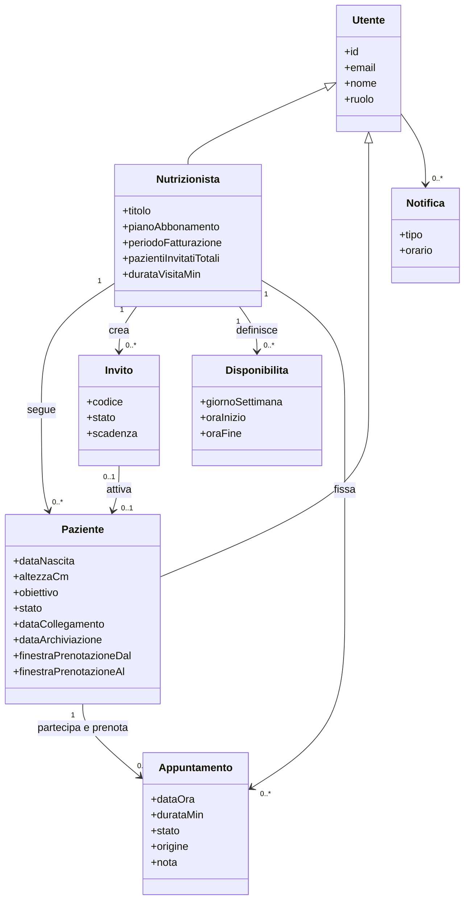
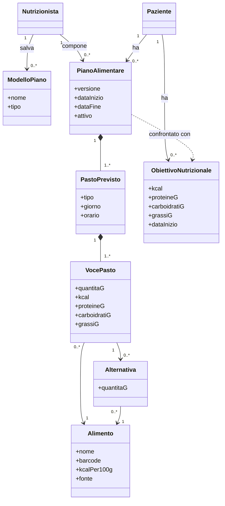
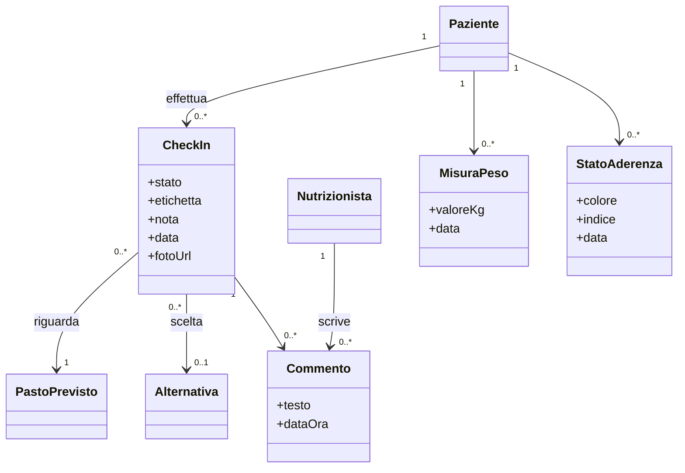

# 3.4.3 Modello ad oggetti (Object model)

## 3.4.3.1 Tabelle degli oggetti

Gli oggetti del sistema sono divisi in **Entity** (dati persistenti del dominio), **Control** (logica che realizza i casi d'uso) e **Boundary** (schermate, pulsanti e form con cui l'utente interagisce), raggruppati per funzionalità.

**Gestione Account**

| Oggetto | Tipo | Descrizione |
|---|---|---|
| Utente | Entity | Rappresenta una persona registrata nell'app, con email, nome e ruolo. |
| Nutrizionista | Entity | Rappresenta il professionista (biologo nutrizionista, dietista, medico dietologo) che segue i pazienti; ha un piano di abbonamento e la durata della visita. |
| Paziente | Entity | Rappresenta la persona seguita da un nutrizionista; ha uno stato (Invitato, Attivo, Archiviato) e una finestra di prenotazione. |

| Oggetto | Tipo | Descrizione |
|---|---|---|
| RegistrazioneControl | Control | Gestisce la registrazione di un utente, con verifica dei dati e del consenso. |
| LoginControl | Control | Gestisce l'accesso di un utente tramite credenziali e il riconoscimento del ruolo. |
| LogoutControl | Control | Gestisce la chiusura della sessione. |
| RecuperoPasswordControl | Control | Gestisce l'invio del link di reimpostazione e il cambio password. |
| ModificaProfiloControl | Control | Gestisce la modifica dei dati del profilo. |
| EliminazioneAccountControl | Control | Gestisce la cancellazione dell'account e dei dati personali. |

| Oggetto | Tipo | Descrizione |
|---|---|---|
| RegistrazioneForm | Boundary | Form con i campi (nome, email, password, ruolo) per registrarsi. |
| ConsensoDatiView | Boundary | Schermata con l'informativa sul trattamento dei dati sanitari e il pulsante di consenso esplicito. |
| LoginForm | Boundary | Form con email e password per accedere. |
| LoginButton | Boundary | Pulsante "Accedi" che avvia l'accesso. |
| LogoutButton | Boundary | Pulsante "Logout" che chiude la sessione. |
| RecuperoPasswordForm | Boundary | Form per richiedere il link di reimpostazione della password. |
| ProfiloPage | Boundary | Schermata con i dati del profilo e le impostazioni. |
| ModificaProfiloForm | Boundary | Form per modificare i dati del profilo. |
| EliminaAccountButton | Boundary | Pulsante "Elimina account" che avvia la cancellazione dei dati. |

**Gestione Inviti e Pazienti**

| Oggetto | Tipo | Descrizione |
|---|---|---|
| Invito | Entity | Rappresenta il codice e il link creati dal nutrizionista per collegare un paziente; ha uno stato (Creato, Utilizzato, Scaduto, Revocato) e una scadenza. |

| Oggetto | Tipo | Descrizione |
|---|---|---|
| CreazioneInvitoControl | Control | Gestisce la creazione di un invito, con verifica del limite del piano di abbonamento. |
| RevocaInvitoControl | Control | Gestisce la revoca di un invito non ancora utilizzato. |
| AccettazioneInvitoControl | Control | Gestisce la verifica del codice e il collegamento del paziente al nutrizionista. |
| ElencoPazientiControl | Control | Gestisce l'elenco dei pazienti con filtro per stato, ordinamento e ricerca. |
| ArchiviazionePazienteControl | Control | Gestisce l'archiviazione e la riattivazione di un paziente, con verifica dei limiti. |
| ScollegamentoControl | Control | Gestisce l'interruzione del collegamento da parte del paziente. |

| Oggetto | Tipo | Descrizione |
|---|---|---|
| InvitaButton | Boundary | Pulsante "Invita" che permette al nutrizionista di creare un invito. |
| InvitoView | Boundary | Schermata che mostra codice e link di invito con il pulsante "Condividi". |
| ErroreLimitePianoDialog | Boundary | Finestra di errore mostrata quando il limite del piano è raggiunto, con le opzioni di cambio piano o archiviazione. |
| InserisciCodiceForm | Boundary | Form in cui il paziente inserisce il codice di invito. |
| PazientiList | Boundary | Lista dei pazienti con semaforo, ultimo check-in e prossima visita. |
| FiltroPazientiSelector | Boundary | Selettore del filtro Attivi / Archiviati / Tutti. |
| CercaPazienteForm | Boundary | Campo di ricerca di un paziente per nome. |
| ArchiviaPazienteButton | Boundary | Pulsante "Archivia" per archiviare un paziente. |
| RiattivaPazienteButton | Boundary | Pulsante "Riattiva" per riportare un paziente archiviato ad Attivo. |
| InterrompiCollegamentoButton | Boundary | Pulsante con cui il paziente interrompe il collegamento con il nutrizionista. |

**Gestione Piano**

| Oggetto | Tipo | Descrizione |
|---|---|---|
| PianoAlimentare | Entity | Rappresenta il piano composto dal nutrizionista per un paziente; ha versione, data di inizio e stato. |
| PastoPrevisto | Entity | Rappresenta un pasto del piano (colazione, spuntino, pranzo, merenda, cena) di un giorno. |
| VocePasto | Entity | Rappresenta un alimento con quantità, kcal e macronutrienti all'interno di un pasto previsto. |
| Alimento | Entity | Rappresenta un alimento con i valori nutrizionali per 100 g, il barcode e la fonte (Open Food Facts o personalizzato). |
| Alternativa | Entity | Rappresenta un alimento sostitutivo ammesso dal nutrizionista per una voce. |
| ModelloPiano | Entity | Rappresenta un pasto o un piano salvato come modello e riutilizzabile. |
| ObiettivoNutrizionale | Entity | Rappresenta gli obiettivi giornalieri di kcal, proteine, carboidrati e grassi stabiliti per un paziente. |

| Oggetto | Tipo | Descrizione |
|---|---|---|
| ImpostazioneObiettiviControl | Control | Gestisce l'impostazione e la modifica degli obiettivi nutrizionali con storico. |
| CreazionePianoControl | Control | Gestisce la creazione, la modifica, il salvataggio e la versione del piano. |
| ComposizionePastoControl | Control | Gestisce la composizione di un pasto, il calcolo di kcal e macro e lo scostamento dagli obiettivi. |
| RicercaAlimentoControl | Control | Gestisce la ricerca di un alimento per nome, tra i recenti o tramite barcode. |
| ClientServizioAlimentiControl | Control | Gestisce le richieste al servizio Open Food Facts e la cache degli alimenti. |
| CopiaGiornoControl | Control | Gestisce la copia di un giorno tipo su altri giorni. |
| ModelliPianoControl | Control | Gestisce il salvataggio e il riuso di pasti e piani modello. |
| ImportazioneCsvControl | Control | Gestisce la lettura del file CSV, l'anteprima e la creazione del piano in bozza. |
| ConsultazionePianoControl | Control | Gestisce la consultazione del piano e degli obiettivi da parte del paziente. |

| Oggetto | Tipo | Descrizione |
|---|---|---|
| ObiettiviForm | Boundary | Form con i campi kcal, proteine, carboidrati e grassi. |
| EditorPianoPage | Boundary | Schermata di creazione e modifica del piano, con giorni, pasti, totali e scostamento dagli obiettivi. |
| AggiungiAlimentoButton | Boundary | Pulsante per aggiungere un alimento a un pasto. |
| RicercaAlimentoForm | Boundary | Campo di ricerca con lista di risultati e alimenti recenti. |
| ScansionaButton | Boundary | Pulsante che apre la fotocamera per la scansione del barcode. |
| QuantitaRapideList | Boundary | Elenco di quantità tipiche (50, 100, 150 g) per inserire una voce con pochi tocchi. |
| AlimentoPersonalizzatoForm | Boundary | Form per inserire un alimento non trovato con i suoi valori. |
| AlternativaForm | Boundary | Form per indicare le alternative ammesse per una voce. |
| CopiaGiornoButton | Boundary | Pulsante per copiare il giorno su altri giorni. |
| SalvaAssegnaPianoButton | Boundary | Pulsante per salvare e assegnare il piano. |
| ImportaDaFileButton | Boundary | Pulsante "Importa da file". |
| ScaricaModelloCsvButton | Boundary | Pulsante per scaricare il modello CSV. |
| AnteprimaImportazioneView | Boundary | Schermata con righe riconosciute, alimenti da abbinare ed errori del file. |
| DietaPage | Boundary | Schermata del paziente con obiettivi e piano, giorno per giorno. |

**Gestione Check-in**

| Oggetto | Tipo | Descrizione |
|---|---|---|
| CheckIn | Entity | Rappresenta la conferma di un pasto da parte del paziente: stato (Seguito, Alternativa, Fuori piano, Saltato), etichetta, nota e data. |
| PastoExtra | Entity | Rappresenta un pasto non previsto dal piano segnalato dal paziente. |

| Oggetto | Tipo | Descrizione |
|---|---|---|
| CheckInControl | Control | Gestisce il salvataggio del check-in e il ricalcolo dell'aderenza. |
| CorrezioneCheckInControl | Control | Gestisce la correzione di un check-in entro il termine consentito. |
| PastoExtraControl | Control | Gestisce la registrazione di un pasto extra. |
| StoricoCheckInControl | Control | Gestisce la consultazione dei check-in passati. |

| Oggetto | Tipo | Descrizione |
|---|---|---|
| OggiPage | Boundary | Schermata Oggi con i pasti del giorno e il loro stato. |
| CheckInButtons | Boundary | Pulsanti Seguito, Alternativa, Fuori piano, Saltato per un pasto. |
| AlternativeList | Boundary | Elenco delle alternative decise dal nutrizionista per il pasto. |
| EtichetteRapideList | Boundary | Elenco di etichette rapide per "Fuori piano" (pizza, ristorante, dolce…). |
| NotaForm | Boundary | Campo nota breve facoltativo. |
| PastoExtraButton | Boundary | Pulsante "Pasto extra". |
| StoricoCheckInList | Boundary | Elenco dei giorni passati con lo stato dei pasti. |

**Gestione Misure e Andamento**

| Oggetto | Tipo | Descrizione |
|---|---|---|
| MisuraPeso | Entity | Rappresenta il peso del paziente in una data. |
| StatoAderenza | Entity | Rappresenta lo stato di aderenza del paziente (colore del semaforo, indice, data). |

| Oggetto | Tipo | Descrizione |
|---|---|---|
| RegistrazionePesoControl | Control | Gestisce la registrazione del peso e l'aggiornamento del grafico. |
| AndamentoControl | Control | Gestisce il riepilogo dell'andamento e i grafici. |
| CalcoloAderenzaControl | Control | Gestisce il calcolo dell'indice giornaliero e del semaforo sulla media degli ultimi 3 giorni. |
| AderenzaPerPastoControl | Control | Gestisce il calcolo dell'aderenza per tipo di pasto e per giorno della settimana. |

| Oggetto | Tipo | Descrizione |
|---|---|---|
| AggiungiPesoButton | Boundary | Pulsante "Aggiungi peso". |
| PesoForm | Boundary | Form con il valore del peso e la data. |
| AndamentoPage | Boundary | Schermata Andamento del paziente. |
| RiepilogoAndamentoCard | Boundary | Riquadro con peso attuale, variazione, aderenza della settimana e ultimi commenti. |
| GraficoPesoView | Boundary | Grafico del peso nel tempo. |
| GraficoAderenzaView | Boundary | Grafico dell'aderenza nel tempo. |
| AderenzaPerPastoView | Boundary | Vista del nutrizionista con le percentuali per pasto e per giorno. |

**Gestione Commenti**

| Oggetto | Tipo | Descrizione |
|---|---|---|
| Commento | Entity | Rappresenta un commento scritto dal nutrizionista su un check-in. |

| Oggetto | Tipo | Descrizione |
|---|---|---|
| CommentoControl | Control | Gestisce la creazione e l'invio di un commento con notifica al paziente. |
| LetturaCommentiControl | Control | Gestisce la consultazione dei commenti da parte del paziente. |

| Oggetto | Tipo | Descrizione |
|---|---|---|
| CommentaButton | Boundary | Pulsante "Commenta" su un check-in. |
| CommentoForm | Boundary | Campo di testo per scrivere il commento. |
| CommentiList | Boundary | Elenco dei commenti del nutrizionista. |

**Gestione Notifiche**

| Oggetto | Tipo | Descrizione |
|---|---|---|
| Notifica | Entity | Rappresenta un avviso inviato a un utente: tipo, orario ed esito. |
| PreferenzeNotifiche | Entity | Rappresenta le impostazioni dei promemoria del paziente (orari e attivazione). |

| Oggetto | Tipo | Descrizione |
|---|---|---|
| PromemoriaControl | Control | Gestisce la programmazione e l'invio dei promemoria dei pasti e delle visite. |
| AvvisiControl | Control | Gestisce gli avvisi su commenti, nuovo piano, prenotazioni e inattività. |
| ImpostazionePromemoriaControl | Control | Gestisce la modifica delle preferenze dei promemoria. |

| Oggetto | Tipo | Descrizione |
|---|---|---|
| NotificaPush | Boundary | Notifica sul dispositivo che apre la schermata pertinente. |
| ImpostazioniNotificheForm | Boundary | Form per attivare o disattivare i promemoria e scegliere gli orari. |
| AvvisiList | Boundary | Elenco degli avvisi ricevuti nell'app. |

**Gestione Visite (Agenda)**

| Oggetto | Tipo | Descrizione |
|---|---|---|
| Appuntamento | Entity | Rappresenta una visita: data e ora, durata, stato (Fissata, Prenotata, Annullata, Svolta) e origine (nutrizionista o paziente). |
| Disponibilita | Entity | Rappresenta una fascia oraria settimanale in cui il nutrizionista riceve. |
| Slot | Entity | Rappresenta un intervallo prenotabile, ricavato dalle disponibilità e dalla durata della visita. |

| Oggetto | Tipo | Descrizione |
|---|---|---|
| DisponibilitaControl | Control | Gestisce l'impostazione delle disponibilità e la generazione degli slot. |
| FinestraPrenotazioneControl | Control | Gestisce la finestra di prenotazione di ciascun paziente. |
| FissaVisitaControl | Control | Gestisce la creazione, lo spostamento e l'annullamento di una visita da parte del nutrizionista. |
| PrenotazioneControl | Control | Gestisce la prenotazione e l'annullamento da parte del paziente, con controllo dello slot libero. |
| CalendarioControl | Control | Gestisce la vista del calendario con visite e slot liberi. |

| Oggetto | Tipo | Descrizione |
|---|---|---|
| DisponibilitaForm | Boundary | Form con giorni, fasce orarie e durata della visita. |
| CalendarioView | Boundary | Calendario settimanale e mensile con visite e slot liberi. |
| NuovaVisitaForm | Boundary | Form per fissare una visita scegliendo cliente, data e ora. |
| FinestraPrenotazioneForm | Boundary | Form per indicare il periodo in cui il paziente può prenotare. |
| VisitePage | Boundary | Schermata Visite del paziente con la prossima visita. |
| SlotList | Boundary | Elenco degli slot liberi nella finestra di prenotazione. |
| PrenotaButton | Boundary | Pulsante per confermare la prenotazione di uno slot. |
| AnnullaVisitaButton | Boundary | Pulsante per annullare una visita. |

**Gestione Aderenza, Dashboard e Abbonamento**

| Oggetto | Tipo | Descrizione |
|---|---|---|
| PianoAbbonamento | Entity | Rappresenta il piano del nutrizionista (Free, Start, Pro) con periodo di fatturazione e limite di pazienti. |

| Oggetto | Tipo | Descrizione |
|---|---|---|
| DashboardControl | Control | Gestisce la dashboard con semaforo, ultimo check-in e prossima visita. |
| DettaglioPazienteControl | Control | Gestisce il dettaglio del paziente (check-in, peso, commenti, piano, visite). |
| AbbonamentoControl | Control | Gestisce la visualizzazione e il cambio del piano di abbonamento (pagamento simulato). |
| LimitePianoControl | Control | Gestisce il controllo dei limiti sugli inviti e sul declassamento. |
| SponsorControl | Control | Gestisce la scheda sponsor statica nel piano Free. |

| Oggetto | Tipo | Descrizione |
|---|---|---|
| DashboardPage | Boundary | Schermata con l'elenco pazienti e il semaforo. |
| SemaforoBadge | Boundary | Indicatore verde, giallo o rosso dello stato di aderenza. |
| DettaglioPazientePage | Boundary | Schermata con i dati del paziente e le azioni disponibili. |
| AbbonamentoPage | Boundary | Schermata con il piano attuale, i pazienti usati e le opzioni. |
| ScegliPianoButton | Boundary | Pulsante per passare a Start o Pro, mensile o annuale. |
| PagamentoSimulatoDialog | Boundary | Finestra di pagamento simulato, chiaramente indicata come tale. |
| SponsorCard | Boundary | Scheda sponsor statica mostrata solo nel piano Free. |

## 3.4.3.2 Class Diagram

**Class Diagram (oggetti Entity)**

Parte 2: piano alimentare.

Parte 3: check-in, commenti, misure e aderenza.

Il campo `CheckIn.stato` assume i valori Seguito, Alternativa, FuoriPiano, Saltato; `etichetta` contiene l'etichetta rapida di un "Fuori piano" (es. pizza). `Paziente.stato` assume i valori Invitato, Attivo, Archiviato. `Nutrizionista.pazientiInvitatiTotali` conta tutti i pazienti che hanno accettato un invito e serve al limite del piano Free.
