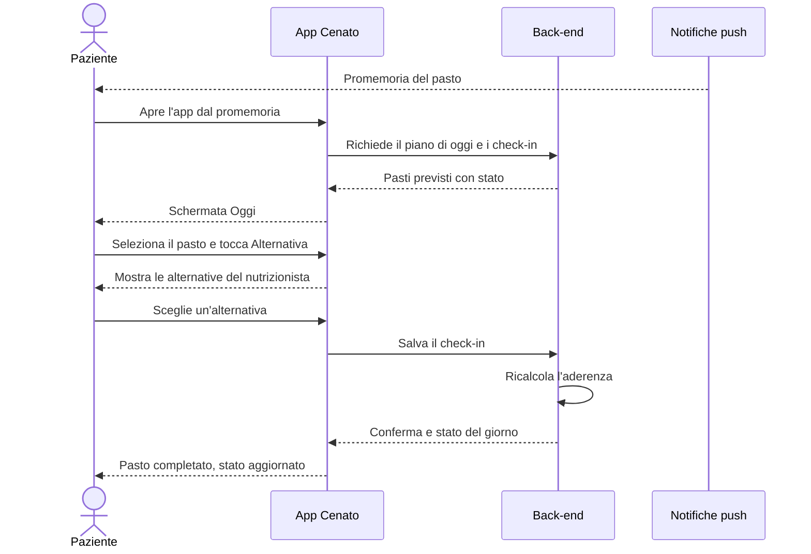
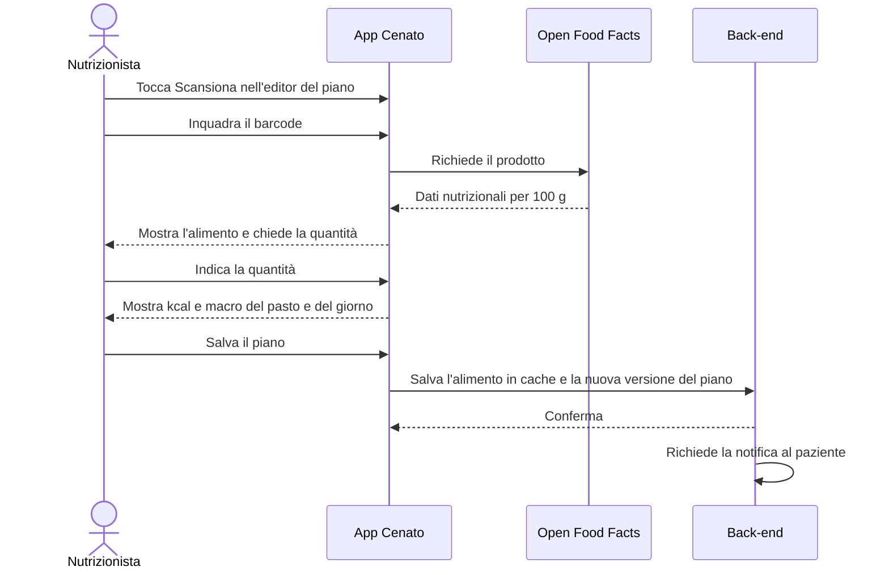
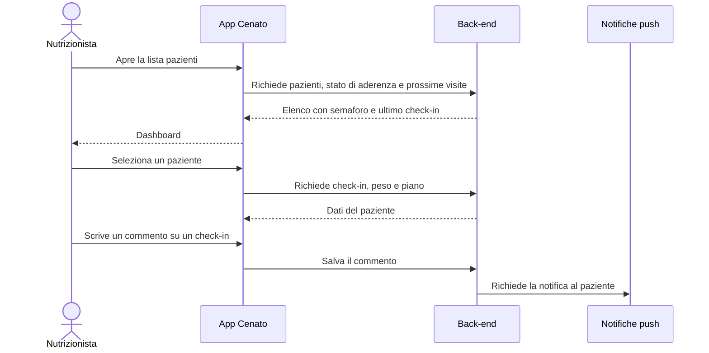
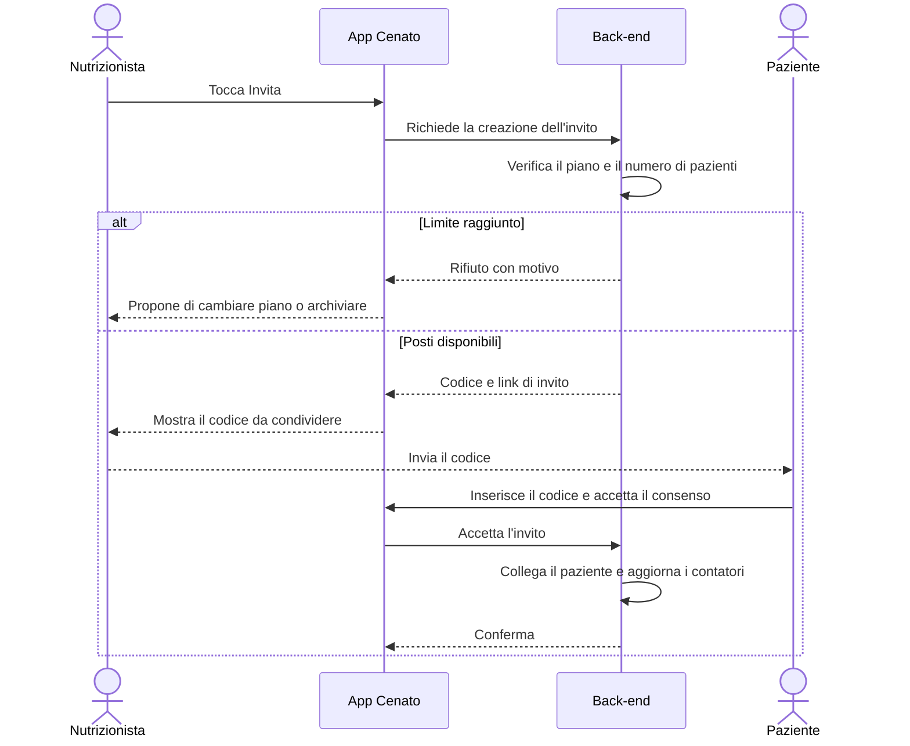
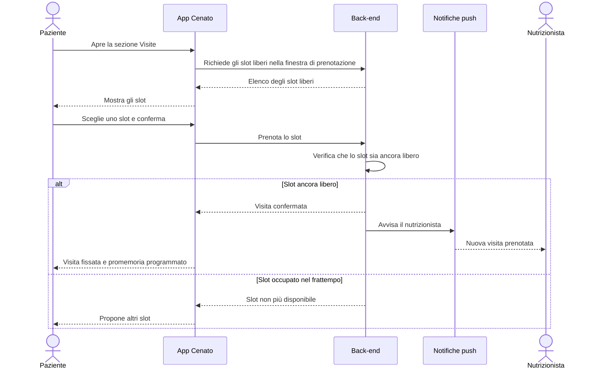
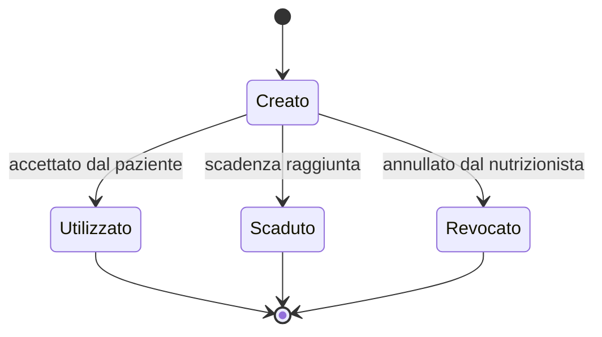
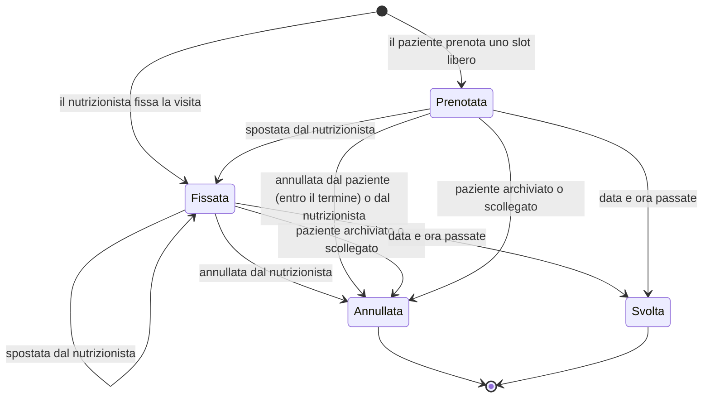
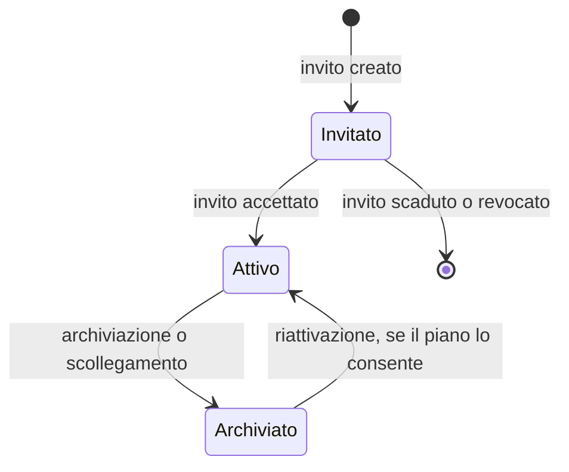

# 3.4.4 Modello dinamico (Dynamic model)

## 3.4.4.1 Sequence Diagram

**SD_1 – Check-in di un pasto (paziente)**

**SD_2 – Composizione di un pasto con barcode (nutrizionista)**

**SD_3 – Monitoraggio dell'aderenza e commento**

**SD_4 – Creazione di un invito con verifica del limite del piano**

**SD_5 – Prenotazione di una visita da parte del paziente**

## 3.4.4.2 StateChart Diagram

**SCD_1 – Stati di un Invito**

**SCD_2 – Stati di una visita**

Nota: dopo l'annullamento lo slot torna libero e il paziente può prenotare di nuovo (una sola visita futura alla volta).

**SCD_3 – Stati di un Paziente (per il nutrizionista)**

Nota: non esiste uno stato "Eliminato" per un paziente che ha accettato un invito. Nel piano Free l'archiviazione non libera il posto; in Start e Pro libera un posto di paziente attivo.
