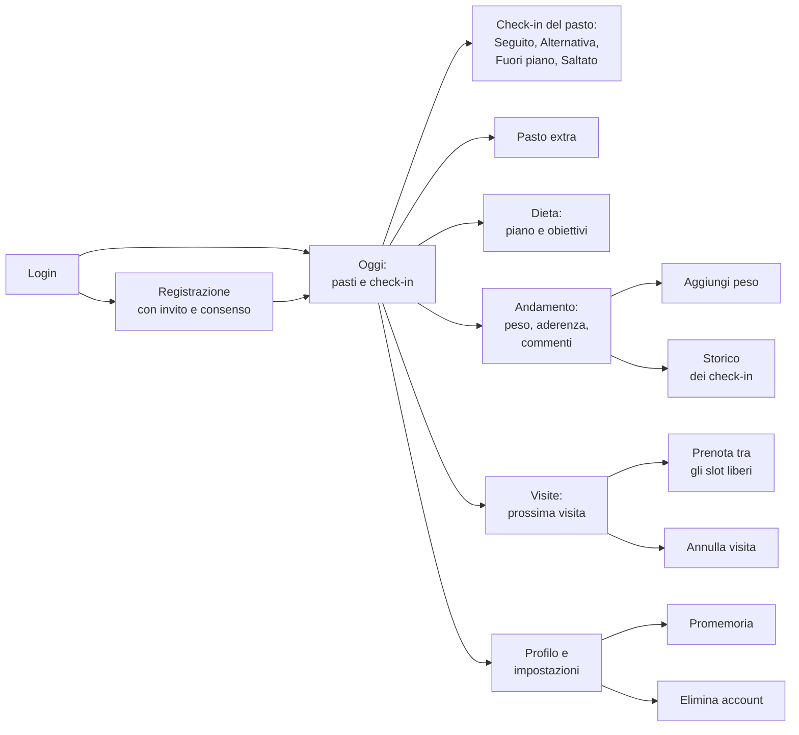
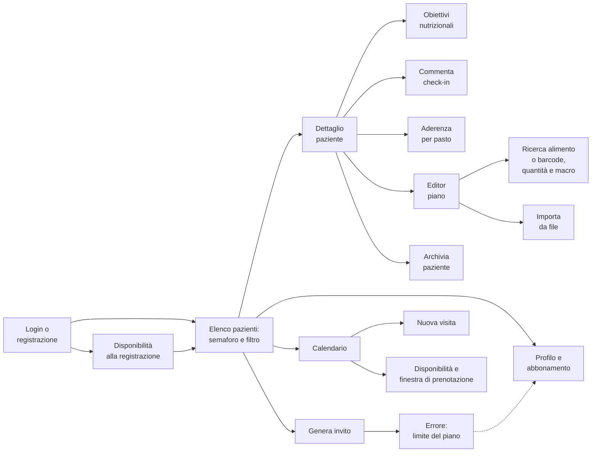
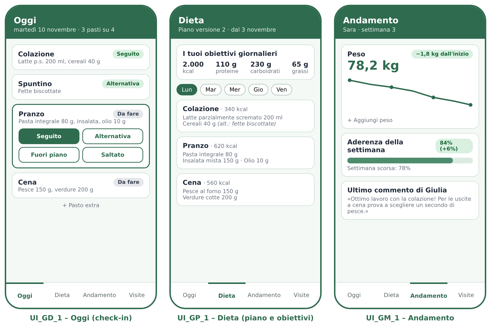
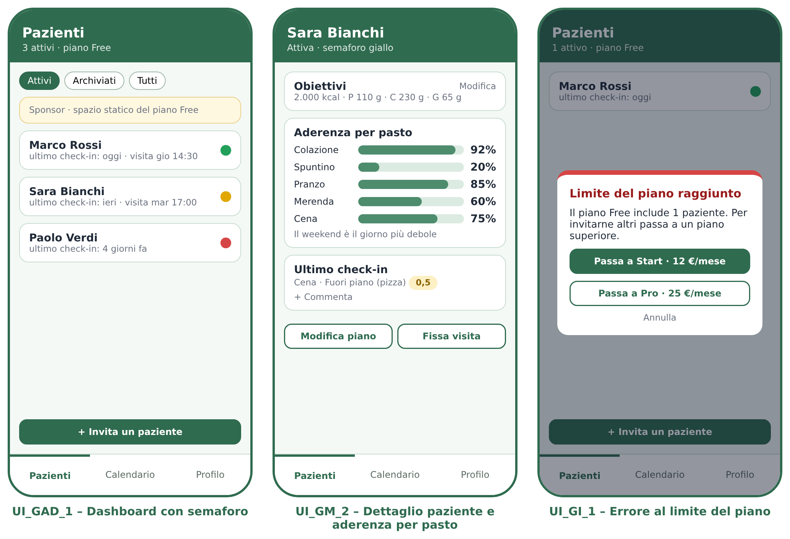
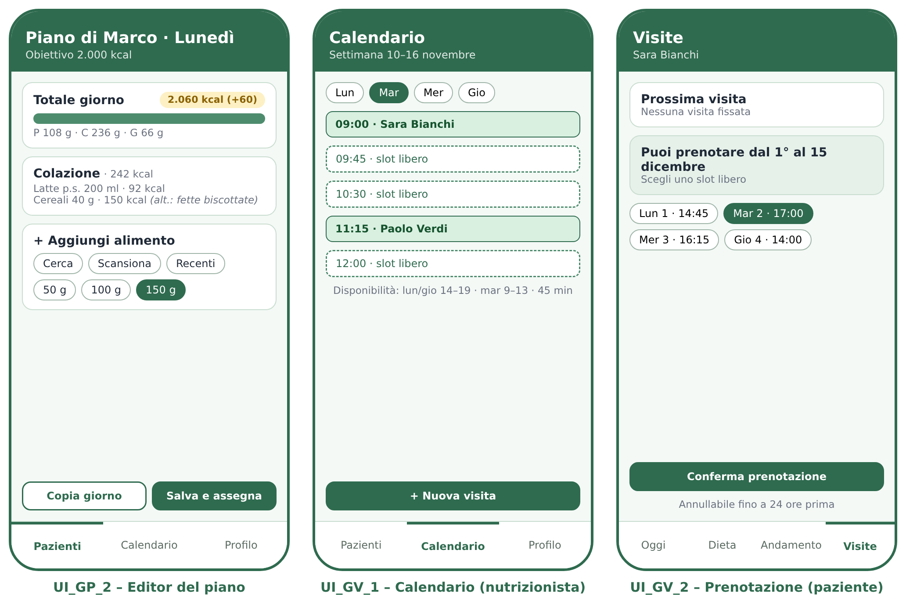

# 3.4.5 Interfaccia utente: percorsi di navigazione e mock-up

## 3.4.5.1 Navigation Path

**NP_1_PAZ – Percorso di navigazione del paziente**

**NP_2_NUT – Percorso di navigazione del nutrizionista**

## 3.4.5.2 Mock-up

I mock-up mostrano ad alto livello le schermate delle funzioni principali; lo stile grafico definitivo sarà coerente con la proposta di valore (rapidità, chiarezza, motivazione). Le schermate del paziente sono le quattro sezioni dell'app (Oggi, Dieta, Andamento, Visite).

