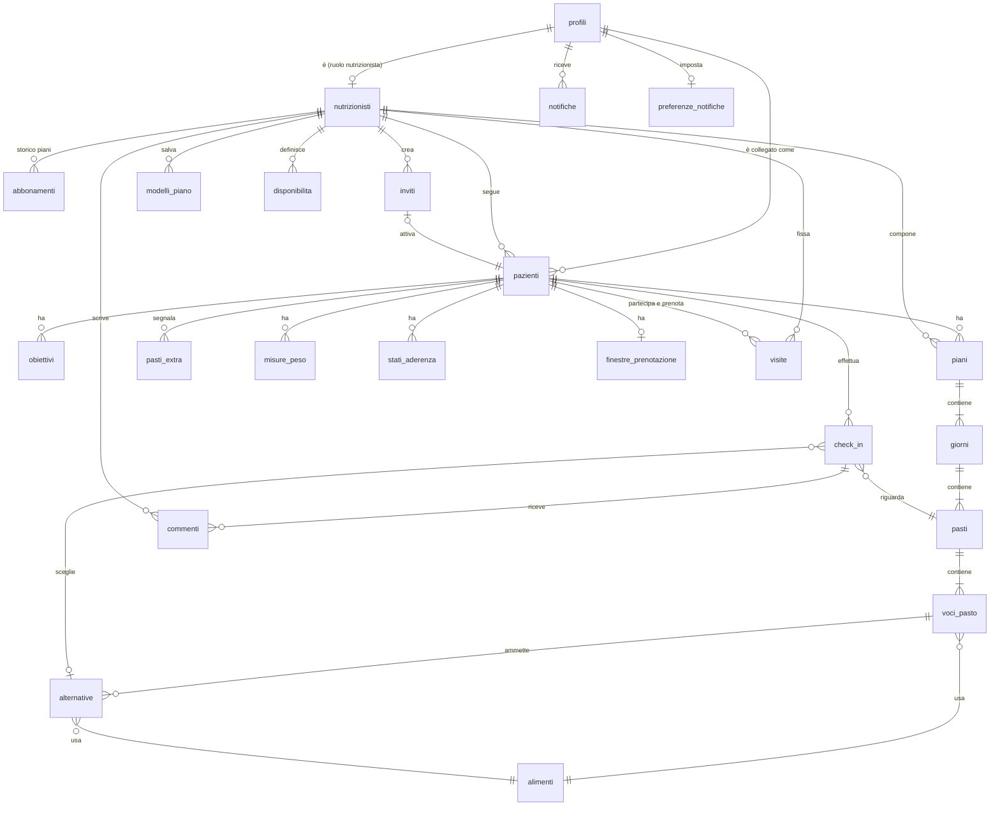

# Schema del database

Schema Postgres di Cenato su Supabase, ricavato dagli oggetti **Entity** e dal **Class Diagram** del RAD (`docs/rad/08-modello-ad-oggetti.md`) e dagli **StateChart** (`docs/rad/09-modello-dinamico.md`).

- Migrazioni: `supabase/migrations/000_profili.sql`, `001_schema.sql`, `002_rls.sql`, `003_abbonamento.sql`
- Test dei vincoli: `supabase/tests/schema_vincoli.sql` (14 controlli, tutti OK il 23/11/2026)
- Policy di accesso: `docs/test-rls.md`

## Diagramma ER

## Tabelle

| Tabella | Entity del RAD | Requisiti | Note |
|---|---|---|---|
| `profili` | Utente | UC_GA_1, RF_GA_1, RF_GA_6 | Creata dal trigger su `auth.users`; ruolo non modificabile; data del consenso |
| `nutrizionisti` | Nutrizionista (+ piano corrente) | UC_GA_1, RF_GAD_4, RF_GV_6 | Creata in automatico con piano Free; durata della visita |
| `abbonamenti` | PianoAbbonamento | RF_GAD_5 | Storico dei cambi di piano, pagamento **sempre simulato** |
| `pazienti` | Paziente | UC_GI_1-5, SCD_3, RF_GI_4, RF_GI_7 | Collegamento persona ↔ nutrizionista con stato; `data_collegamento` = invito accettato |
| `inviti` | Invito | UC_GI_1, UC_GI_2, SCD_1, RF_GI_8 | Codice, stato, scadenza |
| `obiettivi` | ObiettivoNutrizionale | RF_GP_16, UC_GP_6 | Una riga per ogni modifica (storico) |
| `alimenti` | Alimento | RF_GP_3, RF_GP_4, RF_GP_5, RNF_IN_1 | Cache Open Food Facts con `fonte` (ODbL) e alimenti personalizzati |
| `alimenti_nutrizionista` | (recenti e preferiti) | RF_GP_14, UC_GP_3 | Per nutrizionista e alimento: `preferito` e `ultimo_uso`; RLS sulle sole righe proprie (migrazione 006) |
| `piani` | PianoAlimentare | RF_GP_1, RF_GP_7 | Versioni; una sola `corrente` per paziente; `bozza` per l'importazione CSV |
| `giorni` | (parte di PianoAlimentare) | RF_GP_1, RF_GP_13 | 1 = lunedì … 7 = domenica |
| `pasti` | PastoPrevisto | RF_GP_1, UC_GP_2 | Tipo, orario, ordine |
| `voci_pasto` | VocePasto | RF_GP_2 | Quantità, kcal e macro calcolati |
| `alternative` | Alternativa | RF_GP_6, RF_GD_2 | Sostituti ammessi per una voce |
| `modelli_piano` | ModelloPiano | RF_GP_9 | Pasti salvati e piani modello (contenuto in JSON) |
| `check_in` | CheckIn | RF_GD_1-3, RF_GD_7, UC_GD_1 | Quattro stati, etichetta rapida, nota |
| `pasti_extra` | PastoExtra | RF_GD_6, UC_GD_2 | Separati dai check-in: **non** entrano nell'aderenza |
| `commenti` | Commento | RF_GC_1, RF_GC_2 | Su un check-in, con data di lettura |
| `misure_peso` | MisuraPeso | RF_GM_1, RF_GM_2 | Una misura per giorno |
| `stati_aderenza` | StatoAderenza | RF_GAD_1 | Indice e colore per giorno, calcolati in fase 3 |
| `notifiche` | Notifica | UC_GN_1, RF_GN_1-6 | Tipo, orario, esito; nessun dato sanitario nel testo |
| `preferenze_notifiche` | PreferenzeNotifiche | RF_GN_2 | Promemoria attivi e orari |
| `disponibilita` | Disponibilita | RF_GV_6, UC_GV_3 | Fasce settimanali; gli **Slot** si calcolano, non si salvano |
| `finestre_prenotazione` | (Paziente.finestraPrenotazioneDal/Al) | RF_GV_7 | Periodo in cui il paziente può prenotare |
| `visite` | Appuntamento | RF_GV_1-9, SCD_2, RNF_A_6 | Stato, origine, durata |

## Enum

| Enum | Valori | Fonte |
|---|---|---|
| `ruolo_utente` | nutrizionista, paziente | Entity Utente |
| `stato_paziente` | invitato, attivo, archiviato | SCD_3 |
| `stato_invito` | creato, utilizzato, scaduto, revocato | SCD_1 |
| `stato_checkin` | seguito, alternativa, fuori_piano, saltato | RF_GD_1 |
| `stato_visita` | fissata, prenotata, annullata, svolta | SCD_2 |
| `origine_visita` | nutrizionista, paziente | Entity Appuntamento |
| `piano_abbonamento` | free, start, pro | RF_GAD_4 |
| `periodo_fatturazione` | mensile, annuale | RF_GAD_5 |
| `tipo_pasto` | colazione, spuntino, pranzo, merenda, cena | Entity PastoPrevisto |
| `stato_piano` | bozza, corrente, superato | RF_GP_7, RF_GP_11 |
| `fonte_alimento` | open_food_facts, personalizzato | RF_GP_3, RF_GP_5 |
| `tipo_modello` | pasto, piano | RF_GP_9 |
| `colore_semaforo` | verde, giallo, rosso | RF_GAD_1 |
| `tipo_notifica` | promemoria_pasto, promemoria_visita, commento, nuovo_piano, visita_fissata, visita_spostata, visita_annullata, visita_prenotata, finestra_prenotazione, inattivita | GN |

## Vincoli nel database (non solo nell'app)

| Regola | Come è garantita |
|---|---|
| Ruolo non modificabile (CLAUDE.md, regola 6) | Trigger `profili_ruolo_immutabile` |
| Pazienti mai eliminati dopo il collegamento (RF_GI_4) | Trigger `pazienti_non_eliminabili`; nessun `ON DELETE CASCADE` da `pazienti` verso check-in, misure, piani, visite |
| Un solo nutrizionista alla volta per persona | Indice univoco parziale `pazienti_un_collegamento_aperto` |
| Una sola versione corrente del piano (RF_GP_7) | Indice univoco parziale `piani_un_corrente_per_paziente` |
| Un solo check-in per pasto e giorno (RF_GD_1) | `unique (paziente_id, pasto_id, data)` |
| Alternativa solo tra quelle del pasto (RF_GD_2) | Trigger `check_in_verifica` |
| Pasto extra fuori dal punteggio (RF_GD_6) | Tabella separata `pasti_extra` |
| Slot non prenotabile due volte (RNF_A_6) | Vincolo di esclusione `visite_slot_unico` su intervalli sovrapposti, solo per visite fissate o prenotate |
| Una sola visita futura per paziente (RF_GV_8) | Trigger `visite_verifica` con lock per paziente (niente doppie prenotazioni concorrenti) |
| Limite del piano (RF_GAD_4, RF_GAD_7) | Funzioni `limite_pazienti()` e `pazienti_invitati_totali()`, usate dalle RPC di `002_rls.sql` |

## Costanti in un solo punto

I valori **[DA CONFERMARE]** sono funzioni SQL: per cambiarli basta modificare una riga.

| Funzione | Valore | Requisito |
|---|---|---|
| `limite_pazienti('free' / 'start' / 'pro')` | 1 / 5 / illimitato | RF_GAD_4 |
| `giorni_validita_invito()` | 7 | UC_GI_1 |
| `ore_minime_annullamento()` | 24 | RF_GV_9 |
| `prezzo_piano(piano, periodo)` | Start 12 €/mese o 120 €/anno; Pro 25 €/mese o 250 €/anno (centesimi, IVA esclusa) | RF_GAD_5 |
| `privato.posti_occupati(...)` | Free: collegati a vita + inviti in attesa; Start: attivi + inviti in attesa | RF_GAD_4 |

Le soglie del semaforo (0,8 e 0,4) e i punti dei check-in stanno nel codice Dart (`lib/core/costanti`) con la scheda del calcolo dell'aderenza (fase 3).

## Scelte e scostamenti dalla scheda Trello

- **`merenda`** è tra i tipi di pasto perché il RAD (Entity PastoPrevisto) la elenca; la scheda proponeva solo colazione, spuntino, pranzo e cena.
- **Pasto extra** in una tabella separata (`pasti_extra`) invece che come check-in con flag: il RAD lo modella come Entity distinta e così non può entrare per errore nel calcolo dell'aderenza.
- **Pasti salvati e piani modello** in una sola tabella `modelli_piano` con `tipo`, come l'Entity ModelloPiano.
- **`misure_peso`** invece di `misure`: le misure aggiuntive (RF_GM_3) sono priorità B e non si implementano.
- **Paziente "Invitato"**: la riga in `pazienti` nasce con l'invito, senza utente; diventa Attivo quando il paziente accetta. Le righe mai collegate si possono eliminare (invito scaduto o revocato, SCD_3).
- **Foto del pasto** (`CheckIn.fotoUrl`) non inclusa: RF_GD_5 è priorità B.
